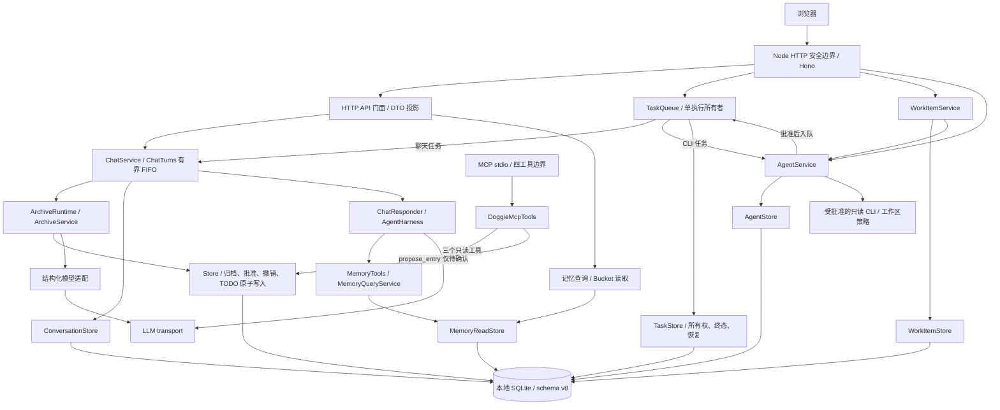
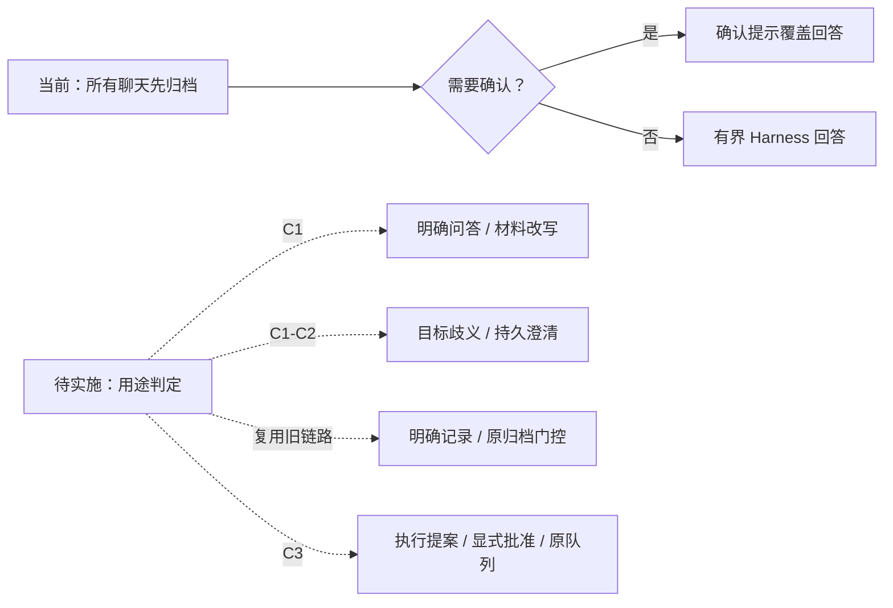
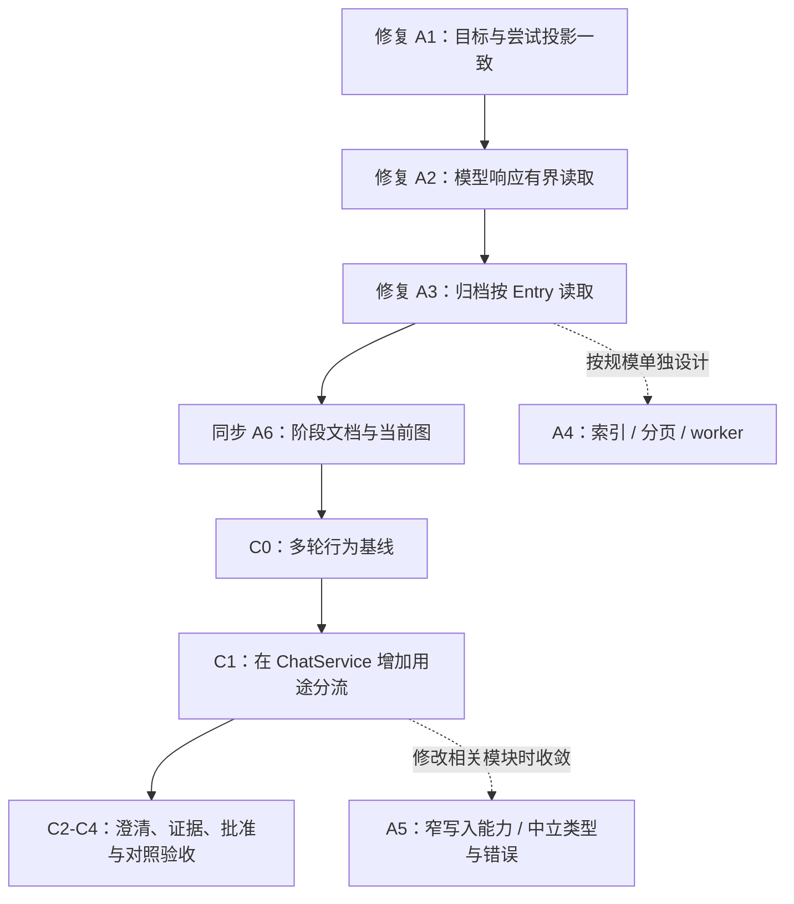

# 更新后后端架构审查

2026-11-19 · 审查基线 `dev_ts@cbf5597` · 只审查与记录，本次不修改业务代码。

结论：后端已形成具备实际用例边界的模块化单体，R0–R5 的主要修缮确实进入代码。当前适合继续个人、本地、单执行所有者的产品路径；但状态投影仍有遗漏、部分热路径仍全量读取，协议依赖和大 Store 也没有全部收敛。不能把修缮验收理解成完整主对话体验或全库分层验收。

## 1. 当前实际架构

以下是调用/数据访问关系，非完整 import 图。`runtime/local-web.ts` 创建依赖并注入同一个 ChatService、同一个 SQLite 连接和单队列执行所有者；MCP stdio 可以在独立进程使用同一数据库文件。



`domain` 为上述组件提供纯规则和类型，不访问 HTTP、数据库或模型。AgentService 与 TaskQueue 的两个方向分别承担入队和执行，不表示任意递归或多个执行所有者。

| 边界 | 当前实现 | 尚未实现或尚未彻底收敛 |
|---|---|---|
| 对话 | HTTP 直接聊天、后台聊天、确认共享 ChatService；FIFO 最多 32 个等待轮次。 | 普通聊天仍走归档优先流程；持久澄清和新请求幂等尚未交付。 |
| 上下文 | 历史先筛选再限量，固定 sequence 上界；终结消息带 source_message_id。 | 不是全历史 RAG，也不是自动隐藏多 session；腾讯记忆不在生产链路。 |
| 记忆读取 | Harness 和 MCP 共享中立只读能力，Entry 查询已按批次分组。 | 仍同步扫描有效语料；旧 Bucket 搜索、详情和归档投影另有全量读取。 |
| 工作目标与执行 | WorkItem、AgentTask/Session、队列分别建模；批准后才运行只读 CLI。 | 多份状态投影的转换分布在具体 Store 中，仍可能漏同步。 |
| 一致性 | 短事务提交；COMMIT/ROLLBACK 故障处理；正常 GET 不做恢复写入。 | Agent 成功与 queue finish 仍是两个提交，由恢复合同处理间隙。 |
| 协议 | 严格 schema、共享 operation/OpenAPI、HTTP/SSE 和 MCP 边界。 | MCP server 的错误映射仍依赖 HTTP；部分公共类型仍来自大 Store。 |

## 2. 已确认的问题

P2 表示应排期处理的正确性、资源或性能问题；P3 表示维护和文档债务。本轮没有证据支持新增 P0/P1 级数据损坏或批准绕过结论。

### A1 · P2：目标范围变更遗漏了最近执行状态投影

证据：[update](../src/storage/work-items.ts#L152)、[#rejectPending](../src/storage/work-items.ts#L390)、[projectAttempt](../src/storage/work-items.ts#L266)。

修改目标会将 pending AgentTask 改为 rejected，但没有同步 `work_items.last_attempt_status`；随后 `scope_revision` 增加，恢复投影遇到旧 scope 直接返回。内存库使用正式 Store API 复现：

```text
创建 WorkItem → 提交 pending 尝试 → 修改 goal
恢复前：goalLastAttemptStatus=pending，actualAttemptStatus=rejected
AgentStore.reconcile 后：goalLastAttemptStatus=pending，actualAttemptStatus=rejected
```

影响是目标列表/详情与执行记录互相矛盾；没有据此发现旧提案可以继续批准。完成/取消也调用 `#rejectPending`，需要同组核对。现有“编辑目标拒绝旧提案”测试只检查 AgentTask，没有检查目标投影。

建议：明确 lastAttempt 字段跨 scope 的含义，在拒绝提案的同一事务内同步或清空对应投影，分别覆盖编辑、完成、取消、重开及重启读取。不得通过让 GET 再次隐式全局恢复掩盖写入遗漏。

### A2 · P2：模型响应大小限制发生得太晚

证据：[transport.send](../src/llm/transport.ts#L174)、[Harness 大小检查](../src/agent/harness.ts#L174)。

Transport 直接 `response.json()`，完整接收并解析之后，Harness 才检查响应对象大小。后置检查能拒绝继续使用超额内容，但无法限制已经发生的读取、分配和 JSON 解析；结构化分类/提取也使用这个 transport。

使用 fake fetch 返回一个 2,097,165 字节 JSON，`transport.send()` 成功返回完整对象。没有联网；这证明 transport 缺少读取上限，不代表生产端点已发生内存故障。

建议：在 transport 逐块读取并限制实际接收字节，超额立即取消流；Content-Length 只做预检查，不能成为唯一依据。明确超额错误是否可重试，避免重复下载同一超大响应。使用无 Content-Length、错误长度、分块超限和取消测试验证。

### A3 · P2：新增一条记录时，归档投影仍读取整个 Bucket

证据：[projectArchiveExecution](../src/application/archive-view.ts#L94)、[getBucketDetail](../src/storage/memory-read.ts#L295)。

为得到本条 Entry 的 memory IDs，投影先读取 Bucket 的全部有效 Entry/Memory，再 filter 本条 Entry。聊天、归档和确认都使用这个投影；一个长期活跃 Bucket 越大，每次写入后的读取成本越高。投影函数因此还隐含了一次昂贵的数据访问。

建议：使用按 entry_id 查询 memory IDs 的窄方法，或由归档提交结果直接带回本次关联 ID。保持撤销/移动和返回合同，验证读取行数不随桶内其他 Entry 增长。这里与 R4 已优化的 Entry 检索路径不同，不能用 R4 基准替它背书。

### A4 · P2：检索与部分列表只有输出上限，没有工作量上限

证据：[Entry 候选读取](../src/storage/memory-read.ts#L155)、[旧 Bucket 搜索](../src/storage/memory-read.ts#L85)、[Agenda](../src/storage/store.ts#L1435)。

- Entry 查询已取消逐 Entry 扫整桶 Memory 的 E×M 关联，但仍读取全部有效 Entry/Memory、Unicode 折叠匹配，再由应用层过滤、排序和截取。
- 旧 Bucket 搜索逐桶读取详情；Bucket detail 与 Agenda 没有分页合同。MCP/Harness 的结果字节检查也发生在查询及对象构造之后。
- 已有修缮合成基准中，3,000 Entry / 18,000 Memory 的单桶零命中同步中位为 91.0ms，前值 468.1ms；同一进程峰值 RSS 为 303,872 → 396,452 KiB。这是 2026-11-18 的合成测量，非本轮重跑、真实用户负载或生产 SLA，详见 [验收记录](BACKEND_REPAIR_ACCEPTANCE.md)。

建议：先去掉 A3 的无效全量读取；搜索索引单独定义 Unicode/metadata/排序等价性、维护事务与迁移，再考虑将大查询移入 worker。分页需设计稳定 cursor 与截断语义，不能简单提前 LIMIT 后声称结果唯一或全局 top-k。

### A5 · P3：分层已经改善，公共依赖与职责仍未收敛

证据：[Store](../src/storage/store.ts)、[TodoService](../src/application/todo.ts#L40)、[MCP server](../src/mcp/server.ts#L5)、[AgentStore](../src/storage/agents.ts#L17)。

`store.ts` 仍有 1,818 行，承担归档、确认、撤销、TODO 原子写入与兼容门面，TodoService 多数方法透传。AgentStore/TaskStore/WorkItemStore 通过具体 Store 协作更新状态；A1 就说明转换路径遗漏的成本。行数本身不证明错误，事务性校验也不应为了分层被搬出事务。

具体剩余依赖包括 MCP server → HTTP stableError、storage/agents → agent/workspace 的类型，以及查询/工具公共类型 → store.ts。当前依赖测试从 chat、memory-tools、Harness、task-queue 四个入口递归检查，不能解释成全后端分层门禁。

建议：将协议无关的错误分类抽成中立结果，HTTP/MCP 各自适配；WorkspaceSnapshot 与共享行类型按实际复用迁移。后续改 TODO/执行状态时提取纯转换规则，保留原子写入；不要为缩短文件机械加入通用 Repository、事件总线或 DI 框架。

### A6 · P3：协作约束与阶段事实漂移

证据：[AGENTS.md](../AGENTS.md#L11) 仍称 R0–R5、C0–C4“均为待实施”，与当前代码和 [修缮验收](BACKEND_REPAIR_ACCEPTANCE.md) 冲突。[修缮设计](BACKEND_REPAIR_PLAN.md) 首节的“当前关系”实际是修缮前图，阅读时也容易误认成最新架构。

建议：更新阶段状态，明确“修缮前基线图”与“当前实现图”；C1 应在已抽出的 ChatService 上增加意图分流，不能重新安排一次 HTTP 聊天抽取。该问题会让后续 Agent 重复重构或依照过时边界编写代码。

## 3. 产品缺口与缺陷分开处理

当前 ChatService 仍先归档再回答；needs_confirmation 时回答内容由确认提示覆盖。普通问题因此可能被归档确认打断。这是已经记录并延后到 C1 的旧产品行为，不能说 R2 抽取后已经实现“正常问答优先”。C2 的持久澄清、requestId 幂等、刷新恢复也仍未交付。

FIFO 只保证单 Web 所有者内的轮次顺序，旧聊天请求没有 durable requestId；网络结果不明时重发仍可能重复。这里应沿 C2 合同补齐，而不是声称已有全局会话锁或跨进程恰好一次。



## 4. 建议修复顺序



保留 TypeScript、Hono、SQLite、单队列执行所有者和现有批准/撤销合同。当前优先级来自可复现问题，不需要以更换框架、拆微服务或接腾讯作为解决手段。

## 5. 本轮验证与范围

- `npm run check`：Prettier、类型检查、OpenAPI/浏览器合同、471 项后端和 60 项前端测试全部通过，0 失败/跳过。
- 两项独立内存复现确认 A1 的投影不一致与 A2 的 transport 超额响应接受行为；通过测试不能覆盖这些尚未写入回归的反例。
- `git diff --check`；人工核对新增文档的相对路径与 Mermaid 围栏。
- 未访问真实数据库、`.env`、API Key，未调用真实模型或网络。保留用户未跟踪 PDF、数据库 sidecar 和其他本地文件。
- 本次仅新增审查文档。A1–A6 的建议及 C0–C4 不能视为已经实施。
