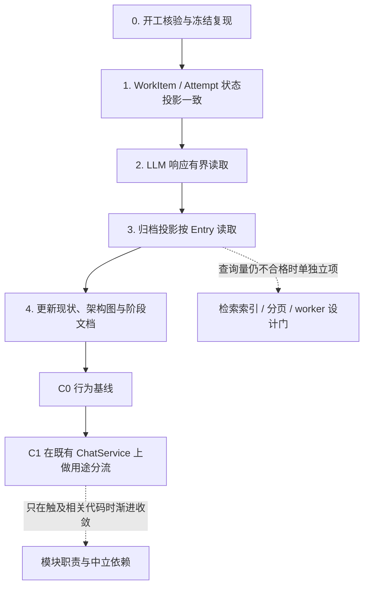

# 后端后续修复与收敛实施计划

2026-11-19 · 依据 [更新后后端架构审查](BACKEND_ARCHITECTURE_REVIEW.md) 编写 · **计划状态：待实施**

本文把审查发现变成后续修改代码时的可执行合同。审查结论来自分支 `dev_ts`、基线 `cbf5597`；实施前先检查当前 HEAD 和工作树，若代码已变更，应重新核对问题及行号，不机械照抄旧补丁。

## 1. 目标与边界

目标是修复可复现的不一致和资源边界，再降低已定位的热路径成本，并让后续主对话工作建立在准确的阶段文档上。完成后继续 C0–C4，而不是在本计划内提前实现主对话产品能力。

保持当前技术和产品边界：TypeScript、Hono、Node `node:sqlite`、单一本地 SQLite、模块化单体、单个队列执行所有者、统一主对话入口；保留 Entry 撤销、确认绑定、显式执行批准、CLI 只读权限及旧 `/api/chat`、MCP、SSE 合同。本计划默认不需要 schema migration。

不纳入：框架替换、微服务/分布式队列、多人协作、远程访问、腾讯生产适配、向量数据库、全历史/RAG、全面前端视觉重做、T15–T17。搜索索引、分页与 worker 隔离需要各自的规模和兼容设计，不得借本计划悄悄引入。

## 2. 依赖关系和建议顺序



S1、S2、S3 相互独立，但按“状态正确性 → 外部资源上限 → 本地热路径”的次序逐阶段验收。每阶段独立提交；若失败，回退该阶段实现而保留已证明有效的复现测试。文档状态更新安排在已完成阶段后，不得先将计划状态写成已交付。

| 阶段 | 对应审查项 | 建议提交单元 | 状态 |
|---|---|---|---|
| 0 | A1–A3 复现与基线 | 复现与修复在各阶段一同提交，不能把红色门禁留在交付分支 | 待实施 |
| 1 | A1 状态投影 | `Keep goal attempt summaries consistent across scope changes` | 待实施 |
| 2 | A2 响应读取上限 | `Bound model response bodies before parsing` | 待实施 |
| 3 | A3 归档查询 | `Read archive memory identifiers by entry` | 待实施 |
| 4 | A6 文档漂移 | 本次已同步导航与历史图标签；完成代码后追加阶段验收记录 | 导航已同步，代码验收待追加 |
| 5a | A4 检索与分页 | 先交独立规模化设计及合同，不自动修改旧 API | 待设计 |
| 5b | A5 职责与依赖 | 按 §8.2 的小批次各自验证、提交 | 待实施，不阻塞 C0 |

## 3. 阶段 0：开工核验与基线

1. 阅读本文件、架构审查、`BACKEND_REPAIR_ACCEPTANCE.md`、`MAIN_CONVERSATION_PLAN.md`、`INVARIANTS.md` 和 `TEST_PLAN.md`。
2. 记录当前分支/HEAD/工作树状态；保护 `.env`、真实数据库、SQLite sidecar 和所有既有未跟踪文件。普通测试只能使用临时/内存 SQLite 与 fake transport/model/runner。
3. 把审查中两个确定反例固定成失败测试，再与对应修复一起提交：
   - WorkItem pending 尝试被拒后，目标投影仍为 pending；
   - fake HTTP 响应体超过上限时 transport 仍完整读取并返回对象。
4. 为归档投影固定读量基线：桶中旧 Entry/Memory 数量增加时，生成新 Entry 的 ID 投影只读取该 Entry 的关联行。优先使用 SQL trace/read-count 测试或窄 storage stub，不以时钟阈值作 CI 断言。
5. 当前 `npm run check` 的审查基线为 471 后端 + 60 前端通过；实施前后都运行相关回归和全量门禁，按实际结果更新数字。

验收：复现测试在修复前能证明问题；没有对真实库做迁移/探测，没有读取凭据或调用真实模型。

## 4. 阶段 1：WorkItem 与 Attempt 状态投影一致性（P2）

### 4.1 要解决的合同

**本计划采用保留历史摘要的语义。** `work_items.last_attempt_id/status` 表示该目标最近一次历史尝试及其当前真实状态，跨 scope 保留；不是“当前 scope 有效尝试”的证明。最新按 `work_item_attempts.sequence` 确定，不能按时间或 UUID 猜测。`agent_tasks.status` 是状态权威；绑定的 `scope_revision` 决定执行资格。修改 scope 后，旧 pending 摘要应为 rejected；重开后可仍显示旧 succeeded/rejected，但不能据此恢复旧 session、批准或自动完成目标。

分开两个效果：① 最近历史尝试摘要可同步；② WorkItem 生命周期、取消收尾和 scope 只能由适用于当前范围的转换驱动。旧范围的晚状态不得重新改变当前目标状态。范围信息保存在 `work_item_attempts`/session binding 中，现有详情 DTO 的 attempts 仅包含 AgentTask 字段，**没有直接暴露 scopeRevision**；本轮不新增 DTO。C1 若需要判断当前尝试，须通过 storage 的绑定读取能力显式取得范围，不能只看 lastAttemptStatus。

目标修改的同一事务必须让 AgentTask、PendingAction、最近尝试摘要和目标事件共同反映结果。不得删掉旧尝试、清空历史来修显示，也不得简单移除现有 scope guard，让旧结果驱动新目标。

### 4.2 修改边界

- 主要代码：`src/storage/work-items.ts` 的 `update`、`transition`、`#rejectPending`、`projectAttempt`；必要时使用 `src/storage/agents.ts` 已有原子写入辅助。
- 让 `#rejectPending` 返回被拒尝试 ID/状态，再由外层 scope/终态更新在同一 `withTransaction` 中同步最新尝试摘要与事件。禁止另开事务；避免先调用会增加 revision 的 `projectAttempt` 再拿旧 WorkItem 值执行外层转换。
- 将 `projectAttempt` 的“历史摘要同步”和“当前 scope 生命周期转换”明确分开。非最新历史 attempt 不得覆盖 lastAttemptId；旧 scope 只允许纠正既有最近摘要，不更改当前 status/cancelRequested/scopeRevision。
- 扩展显式启动/维护恢复，使遗留错误摘要在终态目标或旧 scope 下也能被纠正；只扫描已不一致的摘要，不在 GET 写入。相同修复第二次执行不增加 revision/事件。修复存在实际变更时增加 revision、更新时间并写稳定事件（建议 `attempt_summary_reconciled`），不能修改 scope 或制造新聊天消息。
- 完成、取消和 scope 更新都会拒绝 pending，必须共用一套明确规则；重开不应复活旧提案或旧 scope 的确认状态。
- 运行中的任务当前禁止编辑目标；取消运行中任务按原有 cancel_requested 与执行终止流程，不得误改为已终止。
- 保留 AgentTask 的 rejection audit、PendingAction 单次决议、request replay、防 stale revision、执行批准边界和 WorkItem 来源。
- 不把审计业务状态转换下推成 GET 时恢复，也不使用全局 reconcile 掩盖正常写入漏投影。

### 4.3 必须覆盖的回归

1. 修改目标时拒绝 pending proposal：任务 rejected、PendingAction rejected，目标投影按照已决定的跨 scope 语义一致，事件只写一次。
2. 完成目标与无运行任务的取消：同样终结 pending，投影一致。
3. 有运行任务时请求取消：保持 running/取消请求语义，最终终态仍由 queue/Agent 提交。一目标当前最多一个有效 pending/queued/running 尝试，不构造 pending 与 running 正常共存的伪场景来放宽该规则。
4. 拒绝投影或事件写入触发 SQLite 错误：整个事务回滚，AgentTask、PendingAction、WorkItem、事件均不部分提交。
5. 重启/显式 `reconcile()` 后，不重复事件、不复活 pending、不改变正确投影。
6. 重开已完成/取消的目标：新 scope 生效，旧 attempt 仍保留但不可作为有效批准或执行依据。
7. create/propose 的同 requestId 重放、update/transition 的旧 revision 冲突与重复动作行为不变；不把现有无 requestId 的更新命令描述成已具有重放结果缓存。
8. 已有新 attempt 后收到旧 attempt 的投影调用，不覆盖最新摘要；构造终态/旧 scope 的遗留 pending 摘要，启动修复只纠正摘要，不改变 done/cancelled/open 等当前生命周期。

验收：任一提交后的最近尝试摘要与所指任务真实状态一致；旧 scope 不驱动当前生命周期。事务故障全回滚，已有遗留不一致能通过显式恢复修复且不重复事件；相关回归通过，按实际测试数记录。

## 5. 阶段 2：LLM Transport 按实际字节有界读取（P2）

### 5.1 责任边界

响应体资源限制属于 `FetchStructuredOutputTransport`，因为 `AgentHarness` 和结构化分类/提取共用 transport。Harness 现有的对象/上下文检查可保留作语义检查，但不能充当 wire-body 上限。

新增固定常量 `MAX_LLM_RESPONSE_BYTES = 1_048_576`（1 MiB），作为本轮默认 transport 外层上限，不新增环境变量或用户配置。它是待实施的工程预算，不是模型 token 上限，也不是从请求上下文大小推导出来的；实施时验证现有合法 fixture 均落在边界内。Harness 仍保留原 128 KiB 响应对象和其他输出检查，结构化输出仍受严格 schema 约束。若合法场景确需调整预算，先在脱敏 fixture 中证明并更新文档和边界测试。

### 5.2 读取行为

1. 非成功 HTTP 状态仍先按当前稳定错误合同处理，不读取无上限错误体。
2. 成功响应先检查 Content-Length：合法且大于上限可提前拒绝；缺失、无效或小于真实流长度时，仍必须逐块按实际接收字节计数。
3. 用 `ReadableStream` reader 分块读取，仅在累计字节 **大于** 上限时拒绝，等于上限允许解析。超限立即取消 reader/响应体并抛出稳定、脱敏的 `response_too_large` 错误。使用 `try/finally` 释放 reader 锁；所有退出路径处理流所有权。清理错误不得替换原始分类或暴露响应正文。
4. 单块进入后先检查剩余额度，再复制到容量有界的 buffer；不能先保存全部 chunks 再检查长度。网络栈已经交付的当前 chunk 仍可能较大，因此只承诺累计保留/解析体有界，不承诺进程总内存严格等于 1 MiB。按当前 JSON UTF-8 语义解码，不意外引入 charset 行为改变。
5. `LlmTransportError.kind` 增加 `response_too_large`，retryable=false；`LlmError.transport()` 保留其不可重试性。必须在 transport catch 中保留实例，不把它重新包成可重试的 request error。既有 HTTP/MCP JSON 错误形状不变，不把错误上游映射为用户输入错误。
6. JSON 语法错误仍使用现有稳定映射和重试政策，本轮不顺带重写重试算法。真实 caller/process abort 优先于内部读取错误；timeout 保持现有可重试 transport failure，超时计时器必须覆盖 body 读取、解析前后检查，不能收到 headers 就清除。
7. 非成功状态、提前 Content-Length 拒绝、空 body、解析失败、取消都必须正确终结响应体或释放 reader；取消失败不覆盖主错误。不把 API Key、endpoint query、响应正文或 parser exception 放入错误文案/日志。

字节预算按 fetch 提供的 body 流计数，包括解压后内容；不能只限制压缩 Content-Length。`JSON.parse` 本身仍是同步 CPU 工作，上限降低最坏输入规模，但不是可以抢占解析的硬 CPU deadline，也不能保证上游已经发送的网络字节恰好止于预算。

### 5.3 测试矩阵

- Content-Length 小于上限且合法 JSON；等于上限；大于上限提前拒绝。
- 没有 Content-Length、错误 Content-Length、分块数据刚好到边界、分块跨越边界。
- 大量小 chunk，不能因单 chunk 大小或字符数而绕过总 byte 限制；多字节 UTF-8 边界正确。
- 超限后 reader.cancel 被调用，未继续读取剩余 chunk；读取过程中请求取消、endpoint timeout 与 body stream 错误。
- 边界内 malformed JSON、空 body、非 2xx 大错误体、重试分类、敏感值脱敏。
- 两类消费者都覆盖：StructuredOutputAdapter 正常响应及超限只尝试一次；Harness 不执行该超额响应给出的工具，不保存该响应中的回答/工具数据。之前已提交的归档或已完成的只读调用不因这次失败被撤销，仍沿用当前真实 fallback/审计合同。

验收：超限的真实接收字节在有界 buffer 外即停止，不先完整物化 `response.json()`；`npm run check` 与 transport/Harness 回归通过；没有真实网络请求。

## 6. 阶段 3：归档投影只读取本次 Entry 关联 Memory（P2）

### 6.1 目标

当前 `projectArchiveExecution()` 为本条 Entry 的 Memory ID 调用整个 Bucket 的 `getBucketDetail()` 再 filter。将投影需要的数据收窄为“已知 entry_id 对应的 Memory IDs”，使新增记录的投影成本随本次产生的 Memory 行数增长，不随桶中历史量增长。

### 6.2 实施选择

本阶段选用窄读取方法，保持已有归档执行结果类型和 wire 格式：

1. 在 `MemoryReadStore` 增加拟议方法 `listEffectiveMemoryIdsForEntry(entryId, bucketId): string[]`，Store 仅作兼容委派。SQL 参数化，按 entry_id 与 bucket_id 双绑定，JOIN/EXISTS 确认源 Entry 未撤销且 Bucket 仍存在；只读取 `m.id`，`ORDER BY m.created_at ASC, m.id ASC` 保留旧 filter 后顺序。
2. 无匹配、绑定不符、来源已撤销或 Bucket 已删除时返回空数组，保持旧投影行为；不凭一次读取结果绕过提交时的来源/版本检查。现有 `ix_memory_items_entry` 已提供 entry_id 索引，不新增 schema。测试用实际查询计划确认索引路径，读取计数断言排除全桶 hydrate。
3. `archive-view.ts` 只依赖 `getBucket` 与该窄方法。同步调整 ChatService 当前 store Pick、HTTP 和测试 fake 的调用结构，不改变聊天终结事务或撤销晚结果门控。
4. 普通 Archive、chat auto-archive、chat confirmation、MCP proposal 的投影路径分别确认是否需要 ID 集合，避免只修一个入口。

拟议窄查询的语义如下；最终命名可随现有风格调整，语义不能放宽：

```sql
SELECT m.id
FROM memory_items m
JOIN entries e ON e.id = m.entry_id AND e.bucket_id = m.bucket_id
JOIN buckets b ON b.id = e.bucket_id
WHERE m.entry_id = ? AND m.bucket_id = ? AND e.revoked_at IS NULL
ORDER BY m.created_at ASC, m.id ASC;
```

不加 schema，不缓存 Bucket detail，不在 projection 中直接写 SQL，不改变 Entry/Memories 原子提交方式。

### 6.3 回归与验收

- 保持 archive response 的 `memory_item_ids` 内容、顺序及空值语义与原合同一致。
- 覆盖空 extraction、一个/多个 Memory、确认 append/create/discard、Entry 移动/撤销后重新读取历史卡片、MCP proposal 和历史兼容。
- 建立大量旧 Entry/Memory 的临时库，证明投影查询只读取目标 Entry 的 ID 行；使用 query trace/计数，不用 CI wall-clock 门槛。
- 现有 `getBucketDetail` 的用户展示和 MCP 详情仍保留完整响应；只改变 archive projection 读取方式。

验收：新增一条 Entry 的投影不再 hydrate 整个 Bucket；所有 HTTP、MCP、浏览器合同不变；`npm run check` 通过。

## 7. 阶段 4：纠正架构文档和阶段导航（P3）

本次已同步阶段导航、实际分支与历史图标签；以下清单在 A1–A3 实施验收后继续维护，不能将文档修正等同代码修复：

- `AGENTS.md`：明确 R0–R5 已完成；新增本计划阶段为当前后端跟进待办；C0–C4 仍未实现；说明实施顺序与验收入口。
- `docs/PLAN.md`：更新最后日期、实际分支 `dev_ts`、本轮门禁数字及计划链接。旧历史日期放在历史记录中，不要把 2026-11-03 的讨论标成近期优先级。
- `docs/BACKEND_REPAIR_PLAN.md`：把开篇“当前关系”标为修缮前基线历史图，链接到当前架构审查和本计划；保留其 R0–R5 设计证据，不重写成实现图。
- 本文件：只有阶段验收通过后，才把该阶段标记为“已完成”，补提交 hash、命令和结果。异常或未覆盖范围明确写出。
- `docs/MAIN_CONVERSATION_PLAN.md`：仅当 C1 边界引用过时才更新，保留 C0→C4 产品合同；不得把本后端计划伪装成已交付对话分流。

文档验证：检查相对链接、代码围栏、Mermaid 语法结构、计划与现状用词、命令和测试数；执行 `git diff --check`。Markdown 被 Prettier 排除，格式门禁不代替人工校对。

## 8. 阶段 5：规模化查询与职责收敛——设计门，不自动编码

这些是审查确认的风险，但其实现选择依赖实际目标规模和语义合同，不是 A1–A3 的顺手重构。

### 8.1 搜索索引 / worker / 分页

开始实现前，先交付独立设计，给出：目标数据规模、可接受同步阻塞/内存、查询类型与排序合同、Unicode casefold 和 metadata 覆盖、撤销/移动/状态过滤、top-k 完整性、索引重建、schema migration、事务同步、旧库备份与故障降级。以当前 `scripts/benchmark-memory-read.ts` 的合成脚本建立对照，分别报告读取量、事件循环阻塞、RSS、完整响应指纹。

不得用提前 SQL LIMIT 破坏“全局 top-k/唯一”语义；不得以缓存替代撤销失效合同。索引不是明确需要时可以继续维持同步线性扫描，并公开当前容量限制。Bucket detail 和 Agenda 的分页需要 API/OpenAPI/UI 合同、稳定 cursor 和截断提示，不能擅改已有返回数组。

### 8.2 Store 和应用层收敛

只在修改相邻业务时渐进处理：

- `TodoService` 当前主要透传；优先复用已有 `domain/todo.ts` 纯规则，把确实残留在 Store 的纯状态决策/用户文案移至适当层，不复制另一套校验。storage 仍在一个短事务中做 expected version、有效来源检查、业务行与审计/事件原子提交。
- WorkItem/Agent/Task 的交叉投影先抽纯 transition mapping 或窄写入函数，再由同一事务 owner 执行；不要引入全局 Repository/DI、ORM、事件总线、分布式事务或 event sourcing。
- 把共享 row/value 类型从 `store.ts` 移到按业务职责命名的模块，但保留 Store 作为旧调用兼容门面，直到调用点迁移完且类型/HTTP 合同通过。
- 将通用错误分类/内部稳定错误码从 HTTP 合同移到 domain/application 中立边界；HTTP 和 MCP 各自映射状态码/协议格式，不能让 `src/mcp/server.ts` import `src/http/contracts.ts`。
- `storage/agents.ts` 当前从 `agent/workspace.ts` 引用 `WorkspaceSnapshot` 类型；将纯数据类型归入已有 `domain/agent.ts` 或职责明确的中立模块，不将 fs/git 逻辑搬入 domain。

每次抽取先固定旧输入/输出，限一类变化原因；architecture test 逐步扩展到所有生产入口，显式列出现存允许边界，防止把运行时、测试 fixture 和 CLI 实际集成边界一概禁掉。

| 小批次 | 拟议代码边界 | 完成标准 |
|---|---|---|
| 5b-1 中立错误分类 | 新增 `application/error-classification.ts`；HTTP contracts 与 MCP server 各自适配 | MCP 生产入口传递依赖不再进入 HTTP；HTTP/MCP 原成功与错误形状、脱敏和 isError 语义不变；中立模块不接收 Hono Context 或 HTTP 状态码。 |
| 5b-2 纯类型归属 | WorkspaceSnapshot 归入 `domain/agent.ts`；共享记忆行类型拟议归入 `storage/memory-types.ts`，JSON 值按真实引用选择小模块 | storage 不再为纯类型引用工作区实现；Store 可 re-export 维持兼容；类型迁移不改变运行时校验、SQL 或 wire 字段。 |
| 5b-3 TODO 写入收窄 | 复用 `domain/todo.ts`，拟议 `storage/todo.ts` 接管现有 TODO 方法，Store 委派；TodoService 使用窄能力 | 仅迁移一份实现；计划、重复推进、来源有效性、expectedUpdatedAt、纠错审计和聊天副作用仍同事务；不引入通用 Repository。 |
| 5b-4 执行转换收敛 | WorkItem/Agent/Task 的纯状态映射留 domain/小型共享规则，具体跨表更新仍由事务 owner 编排 | 批准、启动、成功、失败、取消、启动恢复和 pruning 每个入口有原子/故障回归；不以单个状态 mapping 假称跨阶段 exactly-once。 |

以上为待实施路径，新增文件目前不存在。每批通过定向、依赖及完整门禁后再开始下一批；若碰到 API/schema 演进需求，先补专门合同，不把文件拆分作为更改产品语义的理由。

## 9. 本计划不包含但必须避免误报的行为

- 当前主聊天“先归档，确认时覆盖回答”仍为待 C1 改变的产品行为；A1–A3 修复不会改变它。
- C2 durable requestId 和刷新可恢复澄清未实现。旧 `/api/chat` 同网络重试仍不能承诺恰好一次。
- FIFO 只串行化同一 ChatService 实例内的 Web 主对话；不提供跨进程主对话锁。部署边界仍是一个 Web 队列所有者。
- C0–C4 的真实模型质量和真人自用验收是独立验证，不由 fake 回归或本计划替代；本计划不得读取 `.env` 或调用真实模型。
- R4 已证明固定合成语料上响应指纹一致并降低关联工作量；不声称当前已有倒排索引/有界查询，也不否认其 peak RSS 增长。

## 10. 每阶段完成门槛

### 10.1 修改文件与定向验证

下表路径均为当前已有文件；若抽出辅助文件，必须在阶段记录中说明。测试命令从仓库根目录运行，无网络、无 `.env` 依赖。

| 阶段 | 主要修改文件 | 最小测试入口 |
|---|---|---|
| 1 | `src/storage/work-items.ts`，必要时 `src/storage/agents.ts`；对应 `.test.ts` | transactions、work-items、agents、agent/control |
| 2 | `src/llm/transport.ts`，必要时 structured-output；对应 `.test.ts` 与 `src/agent/harness.test.ts` | transport、structured-output、cancellation、Harness |
| 3 | `src/storage/memory-read.ts`、store 兼容委派、`src/application/archive-view.ts`、chat 中窄依赖；对应测试 | store、chat、HTTP api/revocation、MCP tools/server、runtime/core-flow |
| 4 | AGENTS、PLAN、本计划、修缮历史图说明及必要的主对话交接说明 | 文档链接/状态人工核对、完整门禁 |

```bash
# 阶段 1
node --test src/storage/transactions.test.ts src/storage/work-items.test.ts src/storage/agents.test.ts src/agent/control.test.ts
# 阶段 2
node --test src/llm/transport.test.ts src/llm/structured-output.test.ts src/llm/cancellation.test.ts src/agent/harness.test.ts
# 阶段 3
node --test src/storage/store.test.ts src/application/chat.test.ts src/http/api.test.ts src/http/entry-revocation.test.ts src/mcp/tools.test.ts src/mcp/server.test.ts src/runtime/core-flow.test.ts
# 每次阶段交付
npm run check
git diff --check
```

### 10.2 交付条件

阶段代码提交前：

1. 相关定向测试通过；新增测试对本阶段失败模式有辨别力，不只是复刻实现。
2. 安全/原子边界回归通过：审批、撤销、取消、状态版本、消息来源、SQLite 故障隔离、请求/响应限额。
3. `npm run check`、`git diff --check` 通过；真实模型/用户库未触碰。
4. 代码审查阶段 diff，确认没有把业务逻辑挪进 HTTP/MCP、没有异步等待占据 SQLite transaction，也没有宽泛兼容 fallback 掩盖错误。
5. 一个阶段一个祈使式提交；测试失败则停止扩大到下一阶段并保留证据，不删除/跳过既有测试。

### 10.3 回退与剩余风险

本计划预计不升级 schema，不操作真实数据库。代码回退使用受影响阶段的独立 revert，保留此前正常阶段和用户改动；不 reset 工作树，不删库、不降级 schema。状态修复采用现有启动/显式维护恢复路径，但实际自用库上的运行另须遵守备份/恢复与用户授权规则，测试只演练临时库。

回退阶段 1 的代码不会自动还原已写入的历史摘要/事件；不得人工撤销真实审批或删审计来模拟代码回退。阶段 2 的上限会有意拒绝过去能被完整读取的超大响应，需明确兼容影响；阶段 3 须保留原顺序和有效性筛选。后续若实现迫使 schema/API 改动，应先补迁移/兼容与失败恢复设计，再执行该新增范围。

阶段总结统一记录：基线与提交、实际改动、语义与兼容变化、定向/完整验证、旧库临时恢复演练、剩余限制、下一入口。已有审查报告保留为历史证据；新实现状态追加到本计划，不能重写成“审查时已经修复”。

## 11. 文档交付与当前状态

2026-11-19 本轮仅交付计划、导航同步和修缮前历史图标签；阶段 1–3、5a/5b 均未编码。定向测试命令已在当前代码上执行，151 项通过，说明引用命令有效，不表示拟议修复已被测试证明。文档链接与围栏已核对；完整门禁结果以本次交付总结为准。

阶段 1–3 和对应验收记录完成后，下一步进入 [主对话计划](MAIN_CONVERSATION_PLAN.md) C0；C1 直接复用已存在 ChatService，不重复 R2/R3 抽取。只有规模化设计门得到数据支撑时，才另行安排索引或分页的独立实现计划。
