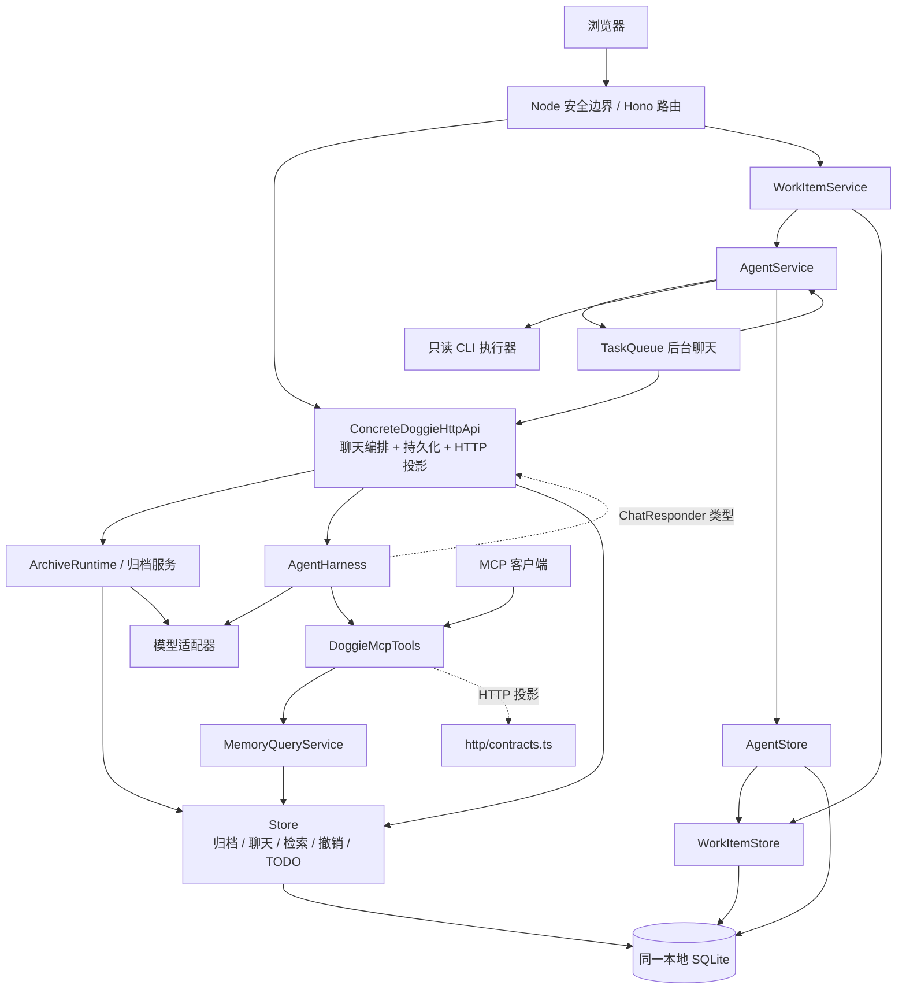
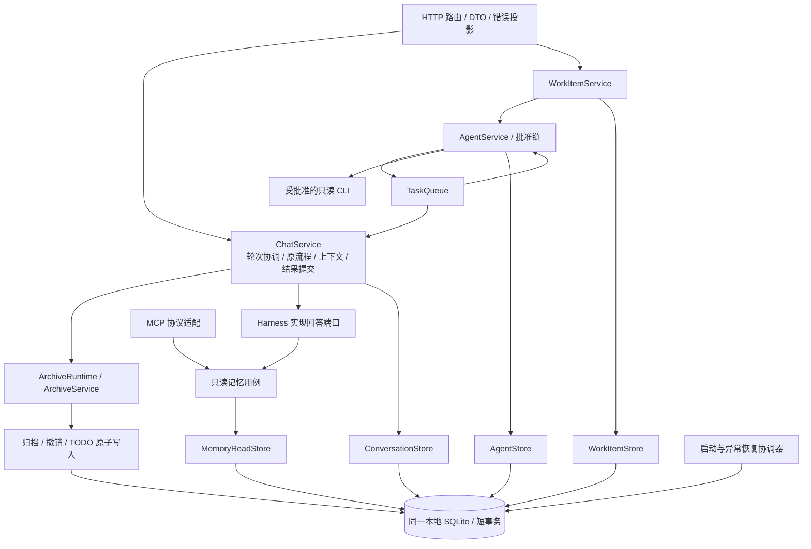

# 主对话实施前的后端修缮设计

2026-11-18 · 基线 `codex/main-conversation-backend@e319dc2` · **R0–R5 已完成，验收记录见 [BACKEND_REPAIR_ACCEPTANCE.md](BACKEND_REPAIR_ACCEPTANCE.md)。**

本文修缮与验收已完成；下一步进入 [主对话计划](MAIN_CONVERSATION_PLAN.md) C0–C4。继续使用 TypeScript、Hono、SQLite、原有队列与批准规则；修缮不引入腾讯生产适配、向量库、远程设备或通用子 Agent 平台。

## 1. 当前关系：调用职责跨过了目录边界

实线为调用/数据访问，虚线为类型或结果投影依赖。省略无关方法；这不是完整 import 图，也不表示每条箭头都需要接口抽象。

`runtime` 负责现有对象的创建与注入。AgentService 与 TaskQueue 的双向箭头表示提交/执行回调，不是无限递归。其余待改点：后台聊天依赖 HTTP 类；Harness 经 MCP 工具绕回 HTTP 投影；Store 包含多个变化原因；读取 WorkItem 时顺带全局恢复。

## 2. 证据与影响

| 编号 | 已核对的位置 | 问题及证据范围 | 修缮 |
|---|---|---|---|
| F1 | [withTransaction](../src/storage/database.ts) | COMMIT 在 catch 外。独立内存库延迟外键可复现提交失败后事务仍打开；当前产品没有该延迟约束，不能说常规请求已触发。 | R1 保护提交与清理，故障隔离。 |
| F2 | [chat](../src/http/api.ts)、[直接路由](../src/http/app.ts) | A 等归档时 B 完成，A 随后读取 B 的消息/回答；单后台队列不能约束直接聊天入口。已有 fake 模型交错复现。 | R2 所有会改变对话轮次的入口共用协调器，固定历史上界。 |
| F3 | [listModelChatMessages](../src/storage/store.ts) | 先取最近 40 行再过滤。40 条目标消息能挤掉仍有效的普通聊天。 | R1 过滤后取 limit，保留撤销边界。 |
| F4 | [resolve](../src/application/work-items.ts)、[list](../src/storage/work-items.ts) | 解析完整标题依赖最近 100 条列表。旧目标会被遗漏；两个同名目标若一个掉出列表，会误报唯一。 | R1 用独立完整标题查询证明唯一/歧义。 |
| F5 | [searchEntryCandidates](../src/storage/store.ts)、[排序](../src/application/query.ts) | LIKE 预筛后仍读全库，逐 Entry 再扫描整桶 Memory；top-k 最后才截断。审查合成数据 3,000 Entry / 18,000 Memory 的零命中查询约 464–588ms；非真实用户负载或 SLA。 | R4 去除重复读取与 E×M 工作，保持匹配语义并测量。 |
| F6 | [HTTP facade](../src/http/api.ts)、[组装](../src/runtime/local-web.ts)、[Harness](../src/agent/harness.ts)、[MCP](../src/mcp/tools.ts) | 业务流程与协议层交叉；后台聊天调用 api.chat，内部能力需要 HTTP 类型/投影。 | R2/R3 独立对话用例和只读记忆能力。 |
| F7 | [Store](../src/storage/store.ts)、[TODO 服务](../src/application/todo.ts)、[WorkItemStore](../src/storage/work-items.ts) | 大 Store 管多业务；状态决策、文案和 SQL 混合，部分用例只透传。 | R3 先抽对话/查询模块和纯规则，保留同事务提交。 |
| F8 | [读取前 reconcile](../src/application/work-items.ts)、[AgentStore](../src/storage/agents.ts) | 一次目标读取触发队列恢复、目标恢复、丢弃 Agent 列表后再恢复目标；至少三次写事务。是有意补偿但入口和成本不合理，未据此断言数据错误。 | R4 明确正常状态投影、异常恢复和只读查询的入口。 |

## 3. 修缮后的目标关系

`runtime` 创建同一 ChatService、协调器和依赖，注入 HTTP 与队列。领域规则供各用例调用，禁止依赖 HTTP/MCP；只读记忆用例返回中立结果，HTTP/MCP 各自投影。双方确实共享的 wire 字段可放小型中立 projection 文件，保留原协议格式；不建立容纳所有类型的全局 contracts 大仓库。

## 4. 具体修缮合同

### R0：固定基线与复现

将 F1–F4 的临时复现变成回归测试；加 F8 恢复调用次数/副作用测试，为 F5 保存可复现合成语料与基准命令。新测试先证明旧行为有问题，再随修复提交转绿；不把失败测试跳过后宣称验收完成。保留现有归档、确认、撤销、取消、SSE 与真实 socket 测试作为行为基线。

### R1：事务、完整性查询与历史读取

**事务。** BEGIN 成功后，业务函数与 COMMIT 在同一受保护区。失败时仅在连接仍处于事务中执行 ROLLBACK；回滚成功保留原始异常。若回滚失败，用内部因果链同时保留两次错误，对外稳定映射为存储不可用；将该连接交给统一故障关闭路径，停止接收写命令和 worker，不能继续作为健康服务或自动重放。runtime 负责 drain 后关闭，不能在活跃请求中随手 close。BEGIN 失败不回滚别人的事务；嵌套事务保持拒绝。明确 callback 只能同步，增加类型约束与 thenable 防护；不能把 async callback 运行后回滚当作可支持的异步事务。

验收：业务失败、延迟外键触发 COMMIT 失败后可再次正常事务；注入回滚失败时连接隔离且原错误仍可诊断；已有故障队列/关闭测试通过。注入只用于临时连接，不修改生产约束来制造失败。

**完整标题。** `WorkItemStore` 新增按完整标题精确查询的方法，和展示列表分离；现有领域解析语义保持。先在全库按完整标题匹配，再按既有展示顺序返回最多 100 项；有两条结果即可确定歧义，截断不影响唯一性判定，候选不宣称穷尽。ID 查询不经过列表。当前完整标题匹配规则不扩展为模糊匹配。验收 101+ 目标、旧目标、窗口外同名、终态目标及不存在 ID。

**模型历史。** 在 SQL 筛选 user/assistant、撤销 sequence 边界和非 WorkItem 消息后，按 sequence 倒序取 limit，再还原正序。提供可选 `throughSequence` 上界供 R2 使用；JSON 字段检查保留原语义，对非法历史 JSON 的处置明确失败而非宽松恢复。审计 details 不送模型，工具输出不占普通历史的条数。保持页面全历史读取独立。验收目标/工具消息超过 40 条、无可用历史、撤销后不能回补旧事实和上界裁剪。

R1 实施记录：延迟外键 COMMIT 失败、SQLite 自动回滚、回滚再失败、目标超出列表及模型历史挤占均已通过临时库回归。连接清理失败时封禁后续事务与队列写操作，Web 停止监听并按既有关闭顺序结束请求与 worker，再关闭 SQLite；故障连接不尝试释放持久队列所有权，由进程退出后的新实例按既有规则恢复。这一阶段没有 schema 迁移。

### R2：对话用例与轮次协调

先从 `http/api.ts` 抽出 ChatService，迁移 chat/confirmChat 的编排与失败结果持久化；保留现有「先归档、再回答」及确认卡覆盖回答的行为，意图分流留给 C1。输入/结果/ChatResponder 端口属于应用层；HTTP 负责 DTO 与状态码，后台执行器直接调用 ChatService。抽取和行为修复分开提交，保持旧 HTTP 返回形状与队列结果合同。

**并发选择：同一本地 Web 实例的主对话轮次串行。** 直接 chat、后台聊天和 confirmChat 使用 runtime 注入的同一个有界 FIFO 协调器；队列 worker 不二次提交到自身。等待轮次受 AbortSignal 取消、容量和请求 deadline 约束；入场后异常也必须释放。等待被取消时尚未写用户消息/归档；执行中取消仍保留已经提交的事实。轮次锁不是 SQLite 事务，不阻止只读查询、Agent 状态观察或 Entry 撤销。跨进程共享写主对话不在该内存协调器保证范围；当前只允许一个 Web 执行所有者，MCP 仍可提交原 proposal。

轮次入场时保存用户消息，以其 ID 标识本轮，固定 `throughSequence` 和记忆版本；在模型调用前读取限定历史。assistant/tool 的 details 增加受检 `source_message_id` 关联，新写记录不以相同原文猜归属；旧记录不回填猜测关系。终结消息组在短事务内提交，避免工具结果已写而最终回答单独失败；已归档图的事务不与远程回答合并。来源在模型运行时撤销，仍按原版本规则拒绝晚答案。结构化执行目标/消息不会因混入时间线而成为上下文。

本阶段使用现有 message ID、sequence、JSON details，预计不迁移 schema；明确轮次标识不等于请求幂等键。旧 chat 无请求 ID 的网络重试仍不能保证恰好一次，新主对话的请求幂等与 durable 澄清由 C2 实现。验收直接 A/B、直接+队列、确认+聊天、等待取消、模型失败释放、运行撤销、终结组回滚；修缮后的 A 只见其边界内的历史，B 在 A 终结后继续。

R2 实施记录：4689219 完成用例抽取，HTTP 和生产聊天 worker 注入同一个 ChatService。协调器限制 32 个等待轮次；等待取消不入库。在事务内核对记忆版本、绑定新结果的 `source_message_id` 并同时写入工具消息及最终回答。故障注入验证终结失败不撤销已经归档的事实；使用原 schema。旧请求超时后重试仍没有持久化幂等保证。

### R3：收窄 Store 与协议依赖

建议新增 `application/chat.ts`、`application/chat-types.ts`、`application/memory-tools.ts`，以及 `storage/conversation.ts`、`storage/memory-read.ts`。这些是拟议路径，文件只在实际拆分时创建。

- ConversationStore 接管消息读取/写入；MemoryReadStore 接管证据和候选读取；现有 Store 暂作兼容门面，旧接口委派给新实现，没有双份实现。新增调用使用窄职责模块。
- Harness 不 import `http/api.ts` 或实例化 `DoggieMcpTools`；MCP 与 Harness 通过共同的只读用例读取，分别适配工具 schema、输出大小和错误。不因复用而把 `propose_entry` 暴露给回答 Harness。
- storage 内面向用户的目标提示文案移到应用层生成；原子创建仍由 storage 一次提交目标、来源、审计和消息，不拆成多事务。TODO/目标纯状态规则可先提取；原子更新继续由具体 store 执行。
- `taskEventStream` 的 SSE 编码归 HTTP 适配；队列只发布内部快照。保留订阅上限、背压、断线取消订阅和 shutdown 行为。

验收用无 Hono/MCP 的 application 测试构建聊天；运行原 HTTP/MCP/前端合同验证 wire 格式不漂移。为受改模块建立依赖检查（包括 type import）：聊天应用模块不得依赖 HTTP/MCP，Harness 不依赖 HTTP/MCP adapter；既有剩余越界列清单，不承诺本轮全库重构。完成标准是移除错误依赖和重复职责，不是文件行数变短。

R3 实施记录：新增 ConversationStore、MemoryReadStore 和中立 MemoryTools，旧 Store 的读接口委派给新模块。HTTP 负责 SSE 编码，WorkItem 文案由应用层提供，仍在一次事务内保存。传递依赖测试覆盖聊天应用和 Harness；原 HTTP、MCP 和浏览器合同验证通过。

### R4：检索与恢复协调成本

**检索先做等价优化。** 将每条 Entry 扫整桶 Memory 改为一次建立 `Map<entryId, Memory[]>`；批量读取查询必需字段，复用 Bucket/标签，避免逐桶获取完整详情；匹配仍使用既有 Unicode casefold、字段覆盖和排序 tie-break。SQL LIKE 命中与 casefold 的覆盖关系用 fixture 证明，只有等价成立才合并冗余扫描。最终命中再水合为公共结果；不要提前 LIMIT 后宣称全局 top-k，更不能为了速度漏掉撤销/状态过滤。

R4 第一轮允许剩余一次线性匹配扫描，**不宣称已经拥有有界成本的索引检索**。规模基准覆盖多桶、单大桶、零命中、宽匹配、Unicode、撤销和筛选；检查数据读取与关联次数由近似 E×M 降为 E+M，报告时间、峰值内存和事件循环阻塞。固定机器重复运行比较中位数，不在 CI 用易抖动的毫秒阈值。若预算仍不满足，应独立设计可重建的规范化搜索 projection/索引、维护事务和迁移，不悄悄添加跨进程失效困难的全局缓存。该后续索引不阻塞正确性修复，但必须记录负载限制。

**恢复入口显式化。** 先去掉通过 `agents.list()` 触发副作用和重复 WorkItem reconcile，暴露显式协调方法。接着在批准/启动/成功/失败/排队取消/运行取消的持久化事务内更新相关投影；队列 pruning 前和启动取得执行所有权后保留全局恢复，必要异常读取只做一次明确的局部修复。Agent 成功与 queue finish 仍分两个既有提交，崩溃间隙由恢复合同处理，不宣称跨阶段原子性。正常 GET 不因每次刷新而重复全局写锁；恢复发现不可能状态仍报错，不吞掉损坏来换取列表可用。

验收每个阶段的崩溃/取消、重复恢复无重复审计、启动不自动重跑 CLI、清理队列后 Agent 引用仍正确；GET 不改变业务快照且不执行重复全局恢复。日志仅记录关联 ID、稳定错误码与耗时，不采集原文或凭据。

R4 实施记录：Entry 候选读取改为固定批量 SELECT 与 entryId 分组，保留 SQL LIKE 和 Unicode 扫描；命中才构造公共结果。合成对照覆盖单大桶/100 桶及五类查询，完整响应指纹一致；单大桶零命中中位 468.1 → 91.0ms，但峰值 RSS 增加，同步线性扫描仍在。正常 GET 不启动写事务，queue 终态同时更新 Agent/审批/目标；启动恢复移入取得执行所有权的事务。原故障矩阵保留，旧漂移改用临时库 SQL 显式注入。471 后端、60 前端测试通过，详见 [验收证据](BACKEND_REPAIR_ACCEPTANCE.md) 和 [原始合成报告](BACKEND_REPAIR_BENCHMARK.json)。

### R5：验收后交接 C0–C4

| 门槛 | 必须交付的证据 |
|---|---|
| 正确性 | F1–F4 回归通过，原事务/批准/撤销/取消边界保留。 |
| 架构 | HTTP 与队列共用应用用例，Harness/MCP 共享中立只读能力；剩余兼容门面及越界项有明确清单。 |
| 性能与状态恢复 | 合成对照数据、确定性复杂度检查、恢复触发点及故障矩阵；不得只报检索耗时均值。 |
| 兼容性 | 旧 API/DTO/SSE、MCP allow-list 与前端行为通过；新增 details 字段有 browser contract 回归。 |
| 门禁 | `npm run check`、`git diff --check`，只使用 fake 模型/runner 和临时数据库，阶段分别提交。 |

R0–R4 不修改用户真实数据库或读取密钥。若需要 schema 变更，使用下一正式版本并另写临时旧库迁移和备份恢复方案；不能把代码 checkout 当数据库回滚。每次抽取可回退到前一提交，涉及语义修复的提交须保留测试。R5 更新实现状态与证据后，C0 复用修缮基线、只增加产品多轮样本；C1 直接在已抽出的 ChatService 增加意图分支；C2 再实现澄清持久化与新接口。修缮阶段不提前交付用户澄清功能。

R5 实施记录：专用分支 `codex/main-conversation-backend` 已完成 R0–R4，完整门禁为 471 后端 + 60 前端通过。合成性能、恢复矩阵、剩余兼容门面和下一阶段入口均在 [验收记录](BACKEND_REPAIR_ACCEPTANCE.md)。C0–C4 仍为规划，不把修缮完成等同主对话澄清完成。
