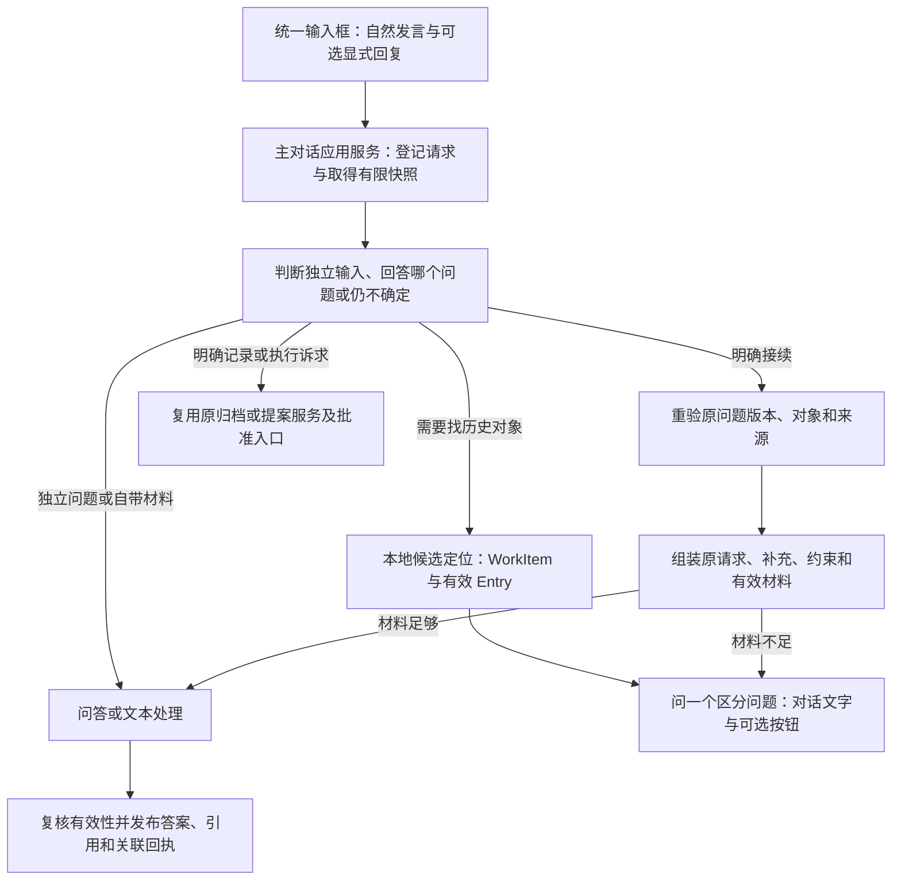

# 主输入框自然续接与历史材料定位设计

2026-11-20 · **N0–N3 已实施并通过自动化验收；C4 对照决策仍待完成。** 本文记录设计与交付边界，不能把固定样本通过解释成任意自然语言的理解质量。详细证据见[验收记录](NATURAL_CONVERSATION_ACCEPTANCE.md)，样本及复现方法见[专项测试方案](NATURAL_CONVERSATION_TEST_PLAN.md)。

## 1. 本轮要解决什么

用户先留下实验 1 的记录，之后留下实验 2 的记录，隔几天在同一个输入框说「帮我修改那个计网实验」。助手能找出已保存的相关材料，问「TCP 三次握手报告，还是 UDP 丢包分析？」用户直接回答「抓三次握手那个，只改报告」，助手应接回原请求；原文足够就给改写稿，缺原文就只问缺少的段落。全程不要求先创建 WorkItem、找到卡片、点击补充或点击继续。

本轮“留下记录”明确指已有归档规则接受的有效 Entry，或已有 WorkItem 及其有效来源。仅在很久以前的普通聊天里提过、或只在磁盘写过文件，仍不保证能够找回。普通聊天中的当前原文可以作为本轮工作材料，但不自动归档。本轮不增加全历史检索、自动历史捕获、腾讯生产接入、向量库、隐藏会话拆分、文件写入或全面视觉改版。

卡片改为可选的候选按钮、来源查看和恢复入口。后台仍保留原请求、回复关联、状态及版本；这类记录是可靠交互的依据，不是要求用户管理的新对象。

## 2. 已有实现与已发现缺口

| 依据 | 当前行为 | 本轮变化 |
|---|---|---|
| [用途判断](../src/domain/chat-purpose.ts) | 确定性规则识别部分引号内材料改写；「原文：……请改写……」可能被当作用途不明。 | 自带材料与明确转换要求优先进入文本处理；覆盖引号、分行和前后置指令，保留混合操作澄清。 |
| [主对话服务](../src/application/main-conversation.ts) | 普通 `message` 与指定卡片的 `reply`、`continue` 分开；目标候选从 WorkItem 池找。 | 新自然输入先解释回复关系，再确定当前用途；候选可以是有效 Entry，也可以是 WorkItem。 |
| [澄清持久化](../src/storage/clarifications.ts)、[schema v9/v10](../src/storage/schema.ts) | 选择字段外键只指向 WorkItem；resolved 只表示已选目标。 | schema v11/v12 增加 awaiting、可见提问、Entry/WorkItem 联合引用；保留既有 ID、版本、请求回执和执行绑定。 |
| [本地查询](../src/application/query.ts) | 已能跨 Bucket 查询有效 Entry；截断后的检索结果没有全库唯一性证明。 | 复用检索生成候选；不把排名第一或返回一条当作用户已选中。 |
| [上下文服务](../src/application/conversation-context.ts) | 工作材料提取和自由改写依赖非空 WorkItem target；无 target 时主要返回验证后的引文。 | 分离操作意图、工作对象和材料，支持无 WorkItem 的 Entry 改写；选择对象后可直接接续只读处理。 |
| [网页输入与卡片](../web/assets/views.ts)、[卡片渲染](../web/assets/render-chat.ts) | 点击补充才能携带回复关联，已绑定后还要点继续。 | 正常输入不要求点击；显示服务端实际关联的对象，保留显式回复、都不是和纠正入口。 |

初始隔离验收中，两个 WorkItem 的澄清、插话与 TCP 绑定已有持久化证据；自带原文改写出现多余追问，「存下来」又触发相同问句。N0–N3 已针对这些缺口完成自动化修复和合成数据对照；当前还没有真实模型质量结论或 C4 默认入口决定。证据与限制见[验收记录](NATURAL_CONVERSATION_ACCEPTANCE.md)。

## 3. 产品规则先于技术选型

1. **讨论对象不等于任务。** 选择一份 Entry 允许读取、引用和在聊天里改写；不创建、完成或重开 WorkItem，不修改 Entry 原文。要长期跟踪或检查工作区时再走已有明确建目标/提案流程。
2. **回复关系与对象选择是两次判断。** 「这是在回答哪个问题」确定以后，仍可能不知道「选哪份材料」。不能因为只有一个待答问题就替用户选候选。
3. **助手问了问题，普通回答应能接续。** 唯一可确定的「三次握手那个」可以选择候选；问完「贴出要改段落」后的「原文：……」可以补材料。不用机械要求按钮或重复全文。
4. **独立问题仍独立。** 「SYN-ACK 是什么？」不消费等待状态；「记一下：……」走归档，不成为报告补充。多张问题都可能匹配时再问一次具体归属，不能按最近一张或前端焦点猜。
5. **只读接续不等于批准。** 自然回复可以关联、读取和生成聊天答案；「好」「执行吧」「存下来」不能消费既有归档或执行批准。保存和 CLI 仍走既有服务与明确批准合同。
6. **时间只辅助定位。** “最新”“昨天”只能在资料确有可靠时间、范围明确时筛选；最近活跃不代表正在说它。等待记录重启后保留，但不能把几天后的每句话自动吸入旧请求。

## 4. 目标架构

不建立独立聊天引擎或通用 Agent 编排平台。主服务负责用例，候选定位与回复解释抽成可注入的小模块，storage 负责原子提交；HTTP 只校验和投影。模型不直接更新状态或返回任意可执行工具。

### 4.1 普通输入怎样接回问题

新网页随自然输入发送自己已读到的交互快照引用：消息上界，以及相关交互的 ID、revision、提问消息 ID。它是防止陈旧页面套用新问题的依据，不是对象选择或操作授权。没有快照的旧客户端继续原行为。

优先级如下：

| 输入依据 | 行为 |
|---|---|
| 显式回复消息/交互、按钮选择 | 按指定对象与 expectedRevision 校验，优先于自然推断。 |
| 完整独立问题、自带材料的新改写、明确新记录 | 按独立输入处理，不因有等待问题就截走；但回答紧邻的“请贴原文”时，带材料的补充应先按下列规则核对。 |
| 当前看见的等待问题询问候选，回复含唯一的完整名称或可验证区分片段 | 保存回复关系，再绑定候选；排除否定、反问、多选与候选池截断导致的虚假唯一。 |
| 当前看见的等待问题明确在要原文，回复明确提供材料 | 只有一个可匹配的材料请求时接回；有多个则问「这是给 TCP 还是 UDP 的？」。 |
| 插话后带明确对象再次回答 | 对可见等待记录作有界匹配；唯一可验证才接回，普通术语插话不清除原问题。 |
| 「这个」「好」「第二个」但上下文不够、多个问题均可匹配 | 不绑定；展示少量可区分问题。序号只对该页面明确展示且版本未变的候选列表有效。 |

上表不是仅靠正则无限扩展。设计允许显式引用、确定性解析与受限结构化模型建议组合；**当前交付只使用确定性解析，没有在回复绑定上调用模型**。如后续加入模型建议，它只能引用服务端候选并附依据片段；服务端仍需验证 ID、版本、否定/多目标和来源。当前“计网”扩词及“三次握手”区分规则是窄范围规则，不能代表通用语义检索。证据片段存在不证明语义正确，仍需单独真实质量评测；confidence 不构成自动绑定依据。不确定时用澄清和按钮降级。

首批仅对同一问题下可确定的候选回复、明确标记的原文补充开放自动接续。超出冻结样本的模糊语义保守追问；不能宣称支持任意对话理解。无明确对象的新材料，同时有旧材料问题时若仍无法区分是新请求还是补充，问一次归属。

### 4.2 从历史记录找对象

- 复用 WorkItem 解析和本地 MemoryQueryService；查询词保留用户主题、实体、日期线索，去掉“帮我修改”等操作词。当前实现含“计网”扩展到 TCP/UDP 的窄规则，仅覆盖已冻结样例，不将其当作通用语义检索能力。
- 候选引用采用带 kind 的联合：`work_item {id, scopeRevision}` 或 `entry {id, memoryRevision}`。同名不合并；相同 ID 去重。已有明确 WorkItem→Entry 关联时，可将资料附在该目标下；没有关系不因标题相近合成一个“实验对象”。多份独立 Entry 可以继续问哪份或哪版。
- Entry 展示来源日期、可定位标题/短摘要及原文区分片段。无明确标题时标注摘要，不伪造权威标题。Bucket 仅作背景，不凭 Bucket 命中证明 Entry 内容相关。
- “那个”请求即使只召回一份也展示建议供确认。用户明确指定稳定 ID 或可验证唯一名称时可直接读取；搜索前五名里唯一不是全库唯一。
- 零候选时说明“在已保存的有效记录中没有定位到”，请给实验主题或原文。不暗示已搜索所有聊天或全部磁盘文件。失效记录不进入候选，正在处理时撤销则终止发布旧材料结果。
- 首批每类最多取 6 个候选用于筛选，合并后展示最多 5 个；Entry 查询使用 `hasMore`，WorkItem 查询保留范围截断状态，合并后不完整性继续传播，不能据截断结果推断唯一。WorkItem 池超过现有 100 条范围会标记不完整。

### 4.3 对话处理与执行分开

选定 Entry 后，原请求、全部已关联补充及该 Entry 原文构成本轮输入；有完整改写要求就直接生成草稿，不要求点“继续”。选完对象但没说怎么改，只问修改要求；材料不足只问材料。

上下文拆成三项：`operation`（问答/检索/改写）、`subject`（WorkItem/Entry/无）和 `material`（有效来源与当前明确提供的段落）。不得创建假的 WorkItem 来让现有 GroundedResponder 允许改写。无对象的自带段落也可直接处理。引用至少支持有效 Entry 和本轮材料消息的 ID；当前材料标注“本轮提供，未归档”，不伪装成长期记忆。

沿用逐字引文验证和发布前的有效性检查；它们只能证明引用存在，不能证明改写每句话都忠实，后者由质量样本单独判断。用户说“改报告”默认先交付聊天草稿；读磁盘材料需要显式工作区与已有批准链，写文件仍不在本阶段范围。

「存下来」不再触发相同的泛化用途问题。若没有唯一可指向的内容，只问“要保存哪段？”；若能定位内容，展示带原文的既有归档入口。来源选择可以自然完成，最终保存仍遵守原归档规则；不能把先前选择材料当作归档批准。首批不新增泛化的自然语言批准器。

## 5. 持久化、协议与兼容

本节已按 schema v11/v12 与当前 HTTP 合同实施。当前数据库 schema 版本为 12；迁移、旧卡兼容和失败回滚由专项测试覆盖。

### 5.1 复用交互记录，不再复制一套状态

扩展现有澄清记录，保持 ID 和 C3 执行绑定。保留当前状态 `pending/resolved/cancelled/stale`：pending 表示待确定对象，resolved 表示对象已定，不表示任务执行成功。增加 `awaiting`（`subject/material/requirements/null`）和对应 `promptMessageId`；取消/失效不得保留可消费的 awaiting，已回答后设 null。pending 只能等待 subject；resolved 可等待 material/requirements，或不再等待。对象已定后缺什么，由本轮输入与验证结果决定，不另造一套任务状态机。

选定引用保留原 WorkItem 外键 `selected_id`，增加显式 Entry 外键，并用约束保证 resolved 恰好选择一种；候选 JSON 通过严格联合 schema 解码。不把 Entry UUID 塞进 WorkItem 字段。SQLite CHECK 变化应通过受控重建表迁移处理，保留外键关系及全部旧行。旧 resolved 行迁移为 awaiting=null，避免升级后自动吸收新发言；不根据旧卡片文字反推未完成问题。

自然续接写入关系来源（显式或自然解析）、原提问消息、选定引用与用于判断的版本；诊断日志只记录 ID/分支/耗时/错误码，不记录原文。关系数据为最小审计，不保存模型推理链。

### 5.2 协议增量

- 保留现有 `message/reply/select/none/cancel/continue/delegate` 合同，旧客户端不自动进入自然续接。
- 在原 turns 入口新增严格的 `action: utterance`，含原 requestId、text、可选显式回复引用及已观察快照。自然解析在后端进行；前端不能先用模型改写为 `reply` 来绕过版本核对。回执继续给已持久化消息 ID 与适用的 clarificationId。
- 新增只读 `GET /api/conversation/interactions`，投影带 kind 的候选、awaiting、promptMessageId、revision 与可见快照，供新预览使用。它读取同一批澄清记录。旧 clarifications 投影继续只给可按旧 WorkItem 合同表达的记录，不把 Entry 字段塞给旧严格客户端；列表遗漏的 Entry 交互仍可由新投影恢复。
- 新输入表达“都不是/取消”或选择 Entry 时，由新 utterance 校验并调用同一状态服务；显式按钮可携带交互和候选引用，不复用旧 `workItemId` 字段。新投影与请求都从共享 schema 生成 DTO/OpenAPI/浏览器验证器。
- 自然续接保留在网页预览开关中；默认关闭。关闭后使用旧 UI 和请求路径，不降级数据库，不隐藏已提交执行任务。C4 尚未决定是否切换默认入口。

新交互 GET 在同一读快照中产生消息上界与交互版本，避免分别读取产生互不一致的客户端视图；它不是整个对话历史的第二份存储。新投影从 N1 即交付，N2 才增加 Entry 分支。所有 awaiting 非空记录共同计入 20 个等待交互的容量限制，不能只数 status=pending。

已观察快照最多含 20 个等待交互，服务端验证消息属于当前本地主对话且提问不晚于消息上界。旧快照下问题已更新则拒绝自动消费、返回可恢复的陈旧提示；不能切到另一个刚出现的问题。不接受任意消息 ID 成为材料或批准来源。没有已观察问题快照时，自然输入可发起新请求，但不得自动消费旧问题；前端先恢复再发送短续答。

### 5.3 事务与慢调用

1. 按原始规范化请求（含快照）登记 requestId 与载荷哈希，读取交互/来源版本。后端解析出的动作不得改变重试载荷哈希。
2. 在事务外进行受限语义解释、检索结果评估与回答；不在 SQLite 事务里等待模型。
3. 短事务重验等待问题、候选、来源及范围，原子写用户消息、回复绑定、选定对象和本轮处理状态。同一自然输入只能属于一个原请求。
4. 需要模型回答时，关联已提交但回复尚未发布可作为可恢复状态；发布前再次复核。不得把“对象已绑定”伪报成“答案已完成”。同 requestId 核对原结果，进程中断仍遵守既有 in_progress 不盲目重发规则；可显式重试只读处理，不能重复写一条补充。
5. 发布助手消息、引用、下一条问题及回执在一个事务内完成。模型失败时保留对象/材料，给稳定可重试提示；撤销、取消和版本变化使晚答案失效。故障注入分别验证关联提交前、提交后和发布时的状态。

首批资源上限：最多 20 个等待交互，模型解释最多读取最近 12 条合格消息和 8 KiB 解释输入；更多等待项不能静默丢弃后声称唯一。解释调用最多一次、不做语义失败重试，模型文本回答最多一次；两者共享请求 deadline，并对 transport 的实际重试计数。C3 可能先用关联材料、再检索调用回答，接入时须改成在本轮总预算内选择，不沿用两轮回答后再叠加解释。沿用 4000 UTF-16 输入上限、32 条补充和 28 KiB 上下文上限；必要约束放不下则失败说明，不能截断后继续。实际 token 上限随模型配置明确，字节上限不等于 token 上限。

## 6. 实施顺序与文件责任

| 阶段 | 修改与交付 | 进入下一阶段的条件 |
|---|---|---|
| N0 用途与材料纠偏（已完成） | 修复自带原文改写的用途识别和“存下来”重复泛问；保留归档与批准边界。 | 固定回归及旧归档/批准回归通过。 |
| N1 普通输入续接（已完成） | 新增 utterance、可见快照、awaiting 与恢复合同；无需点回复卡即可续接唯一问题。 | 插话、多问题、双页陈旧、重放、取消与晚结果回归通过。 |
| N2 有效 Entry 定位（已完成） | schema v12 支持 Entry/WorkItem 联合引用；复用本地检索和有效来源校验，不伪造 WorkItem。 | 合成数据下无 WorkItem 也可定位、改写并显示来源；无额外业务写入。 |
| N3 联合验收（自动验收完成） | 相同合成资料对照旧聊天、C3 显式卡片与自然输入；补齐 loopback 重启和前端合同测试。 | 固定样本和完整门禁通过；真实模型质量、全面浏览器体验与 C4 仍单列。 |

实现文件以实际边界为准：`src/domain/` 定义回复关系/对象联合与纯校验；`src/application/main-conversation.ts` 编排，拆出小型候选定位与关系解析模块；`conversation-context.ts` 组装材料与验证答案；`src/storage/` 封装迁移、CAS、回执和引用查询；`src/llm/` 只承接严格结构化协议/transport；`src/http/` 做 schema/operation/投影；`src/runtime/` 注入依赖；`web/` 发出自然输入与显示关联。不得继续将检索、语义、SQL 和授权全部追加进一个服务文件。

N0–N3 的代码与自动化验收已交付，记录见[验收记录](NATURAL_CONVERSATION_ACCEPTANCE.md)；本文不会改写 C0–C3 的历史完成条件。可以说固定合成场景支持“不预建目标、不点卡片”，不能据此承诺任意语言、真实模型或完整真实浏览器体验均已验收。

## 7. 暂不承诺与后续决策

- 未归档的历史实验找不回：后续单独决定聊天可检索范围及隐私/撤销合同，不通过自动抓全历史填补。
- 已保存来源却因表达不同召回不到：用专项样本先量化，再决定是否重启腾讯/向量比较；本轮报告真实漏召回。
- 多条记录共同构成一个实验，但没有明确关联：先展示来源并澄清，不上通用实体图谱或自动合并系统。
- 长期任务跟踪、真实 CLI/文件修改、全面视觉改版与入口默认切换各有验收条件。此次先解决“对象找得到，回答接得上，材料足够就办”。
