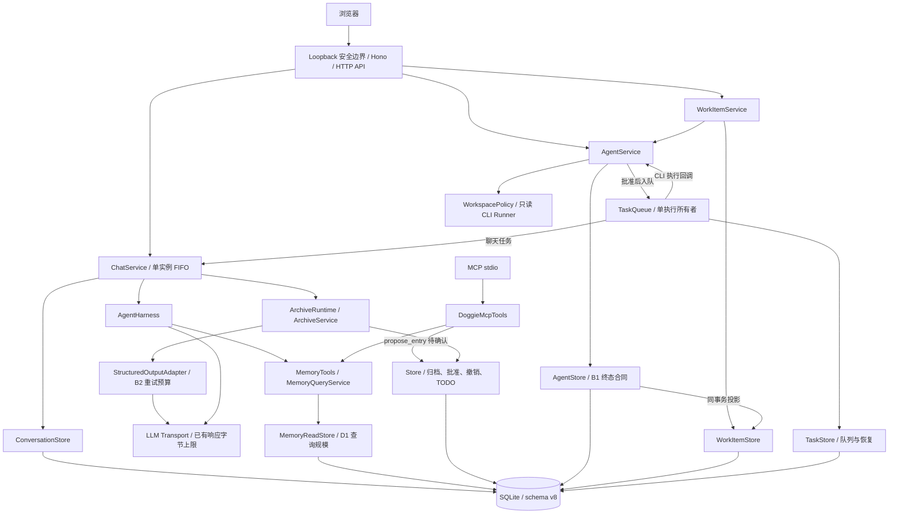
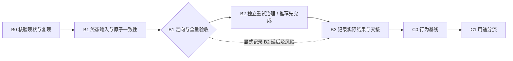

# C0 前后端修缮与设计计划

2026-11-19 · 审查基线 `codex/main-conversation-backend@628256b` · **状态：B0–B3 已完成，C0 前置门禁已通过；后续状态见 C0 验收记录**。

本文替代三份已删除的旧后端计划/审查文档，作为当前修缮入口。删除旧文件是文档收敛，不代表所有问题解决。历史设计可从 `628256b` 的 Git 快照读取；R0–R5 与 A1–A3 的交付证据归入 [后端修缮验收记录](BACKEND_REPAIR_ACCEPTANCE.md)。产品主线仍以 [主对话计划](MAIN_CONVERSATION_PLAN.md) 为准。

## 1. 目标、基线事实与范围

本轮目标是堵住终态写入合同的缺口，并为模型重试补上可执行的资源与失败策略，避免在 C0 基线冻结后继续混入底层行为变更。保留 TypeScript、Hono、schema v8、单机 SQLite、单个队列执行所有者、原归档/确认/撤销/只读执行授权合同。

| 问题 | 实施前证据 | 处理结果 |
|---|---|---|
| A1：目标范围改变后最近尝试摘要错误 | `0dcce2d` 已修复；最新历史摘要与当前 scope 生命周期已分开，包含回滚/重开恢复测试 | 保留回归，不重新实现 |
| A2：LLM 响应先完整读取再检查大小 | `8652db8` 已修复；transport 按实际 body 字节有界读取，超限不可重试 | 保留 1 MiB 限制、取消和资源清理 |
| A3：归档结果投影读取全桶 | `8b7c2d6` 已修复；按 Entry/Bucket 双绑定查询有效 Memory ID | 保留窄查询及查询计划回归 |
| Agent 完成输入能产生矛盾审计 | `AgentStore.complete()` 允许 failed/null；内存复现得到 Agent failureCode=null、PendingAction failureCode=cancelled。常规 AgentService 调用已给出合理值，未证明 UI 必然触发 | B1 已修复，见 §9 |
| LLM 重试无退避/Retry-After/适配器总时限 | 有限重试次数已存在；429/5xx、网络错误等可能立即重发。HTTP 和队列已有 120 秒外层 deadline，不能误称全系统无时限 | B2 已在独立提交实施，见 §9 |
| 检索全量读取、列表分页不足 | 已知规模限制，不是 A3 修复遗漏；当前没有本轮生产负载证明 | D1，独立设计门，不阻塞 C0 |
| Store 集中、协议/类型反向依赖 | 已知维护债；文件长度本身不是错误证据 | D2，相关模块变化时逐批收敛，不阻塞 C0 |

514 项后端和 60 项前端是旧门禁；本次各阶段实际验收见 §9。普通测试不读取 `.env`、真实数据库和凭据，不调用真实模型。

不纳入：框架替换、微服务、通用 Repository/DI/事件总线、腾讯生产接入、向量/RAG、隐藏多会话、远程或多人服务、全面视觉改版、T15–T17。本轮未改数据库 schema、公开 API 或 OpenAPI。

## 2. 当前架构与修缮位置

以下是主要调用/持久化关系，不是完整 import 图。AgentService 的批准入队与队列回调执行是两个不同方向；MCP propose_entry 只产生待确认 proposal，不经过模型自动归档。



`runtime/local-web.ts` 负责生产组装；领域层提供纯规则/类型。现有依赖债仍包括 MCP → HTTP `stableError`、storage → 工作区实现的纯类型引用，以及共享类型集中在 Store。图中分块不表示这些依赖已经消除。

## 3. 顺序、提交与 C0 进入条件



默认实施顺序为 B0 → B1 → B2 → B3 → C0。**硬门槛是 B1 的错误组合不可提交、正常完成/恢复与安全回归通过。** B2 是独立可靠性改进，不冒充批准绕过漏洞；若要提前进入 C0，须在本文明确记录 B2 延后及现有请求次数/外层时限边界，后续重试改动同步更新 C0 基线。D1/D2 不自动加入前置。

每个代码阶段先固定复现，再修复，运行定向检查和 `npm run check`、`git diff --check`，最后独立提交。B3 只在真实检查完成后更新状态、提交 hash、测试数及剩余限制。

## 4. B0：开工核验与冻结复现

1. 核对 HEAD、工作树及本文对应代码，保留用户未跟踪 PDF、数据库 sidecar 和已有改动。不要为了测试启动真实产品。
2. 阅读 `AgentStore.complete()`、`AgentService.execute()`、TaskStore 正常终态/恢复、WorkItem 投影和 PendingAction completion schema，确认三类状态各自权威，不能把 PendingAction 的 failed 与 Agent 的 cancelled 简单视为不一致。
3. 在内存 SQLite 用正式 propose → approve → claim → start 路径构造任务，调用 failed/null 和 succeeded/非空码，固定当前矛盾结果；新的拒绝断言应在旧实现上失败。不要用直接 SQL 构造正常入口实际上不允许的状态来证明漏洞。
4. 用 fake transport 固定目前立即重试、总次数、取消及耗尽错误行为，B2 的新调度测试显式区分旧行为与目标行为。
5. 记录当前 514 后端 + 60 前端只是基线；实际实施重新运行相关检查，不复用旧输出充当新结果。

## 5. B1：Agent 完成合同与审计一致性

### 5.1 目标合同

在领域边界定义 `AgentCompletion` 判别联合和严格 schema，在 `AgentStore.complete()` 写入前做运行时校验；类型约束不能代替存储边界校验。保持 `AgentTask` 既有读取 DTO 兼容，不能仅收紧读 schema 导致历史库无法启动。

| Agent 结果 | failureCode | output / remoteId | PendingAction 投影 |
|---|---|---|---|
| succeeded | 必须为 null | output 保持 64 KiB 上限；remoteId 可选合法 UUID，仍受既有 identity 绑定约束 | executed；结果引用同一 AgentTask；失败码 null |
| failed | 必须为非空稳定错误码，不能为 cancelled；格式复用现有 PendingAction 错误码约束 | output 必须为空；不接受 remoteId | failed；保存完全相同的失败码 |
| cancelled | 必须为 cancelled | output 必须为空；不接受 remoteId | failed；失败码 cancelled（PendingAction 没有 cancelled 状态） |

上述规则已用于验证新的完成写入。失败/取消禁止携带输出或恢复标识，避免将晚结果保留下来；目前生产 AgentService 的失败分支已使用空输出且不传 remoteId。拒绝未知字段、非法状态组合、无效 UUID 以及超额输出，不擅自将 null 推断为 cancelled。

### 5.2 修改边界与执行顺序

- `src/domain/agent.ts`：新增纯类型/schema；复用错误码语法，不复制第二套互相漂移的正则。需要共享时使用最小中立定义，不依赖 HTTP/storage。
- `src/storage/agents.ts`：入口验证 completion；所有身份、scope、记忆版本及任务状态检查继续保留。成功要求 Agent 与关联队列任务都处于 running，此时才允许更新 remoteId。移除 `failureCode ?? "cancelled"` 兜底，以已校验结果同时更新 PendingAction、AgentTask 和 WorkItem 投影。
- `src/agent/service.ts`：以联合类型构造成功、失败、取消结果；保留持久化失败导致 worker fault、撤销/取消丢弃晚结果、成功不完成 WorkItem/TODO 的合同。
- `src/storage/tasks.ts`：核对 queue finish、cancel、启动/pruning 恢复中相同状态映射。取消队列的恢复投影始终写入 cancelled；队列错误码不再覆盖取消的 Agent/PendingAction 失败码。Agent 完成与 queue finish 仍分两次提交。
- 无效完成输入使用稳定、脱敏的内部错误（`AgentError("invalid_event")`）；从 AgentService 进入时保留现有 fault 处理，不能将服务端输出错误投影为 HTTP 用户参数错误。

事务 owner 仍在 storage。输入校验应在首次写入前完成；事务中重新读取状态、检查绑定并提交全部投影，任何一步失败整体回滚。旧 scope 不能驱动当前目标生命周期；重复完成继续按现有 conflict 语义拒绝，不新增隐式重放。

### 5.3 历史数据与回退

本轮没有证据证明真实用户库已经包含矛盾组合，因此不新增启动时全库重写或自动补码。用临时库模拟历史行，确保读取、重开及已有恢复仍兼容；不能声称既有 reconcile 会修复所有终态失败码。若日后实际发现这类遗留记录，单独设计带审计的修复，先确定可信来源，未知原因不能写成 cancelled。

本轮没有迁移 schema；代码可按独立提交 revert，但已提交的真实事实/审计不回滚、不删除。真实库操作不在本计划执行权限内。

### 5.4 必须通过的回归

1. 三个合法结果均通过，Agent/PendingAction 对应状态与失败码精确一致；关联 WorkItem 摘要符合当前历史语义。
2. failed/null、failed/cancelled、succeeded/非空码、cancelled/其他码、空/非法失败码、未知字段全部拒绝；数据库业务行、session、审批和目标事件不变。
3. failed/cancelled 携带 output 或 remoteId 拒绝；成功输出字节上限和 remoteId 绑定仍生效。
4. PendingAction、AgentTask、session 和 WorkItem 投影写入点分别注入故障，断言全事务回滚。保留成功结果先提交、queue finish 失败的既有恢复测试。
5. 取消、撤销、目标 scope 变化及重启后，晚成功不得写入；重复终结不重复事件，正常 GET 不做恢复写入。
6. 两类任务均覆盖：独立 AgentTask 与关联 WorkItem 的尝试；queue cancel/failed/interrupted/pruning 合同不退化。

## 6. B2：独立的模型重试治理

### 6.1 边界与默认设计

这是结构化分类/提取的推理重试，不是归档数据库提交、CLI 执行或腾讯远端写操作的重放。Harness 当前直接使用 transport，不因 B2 获得额外自动重试；transport 每次 send 仍只发一个请求。

保留生产默认最多两次重试（三次请求）；加入可取消退避、Retry-After 和一次 `StructuredOutputAdapter.generate()` 的总预算。默认总预算 **90,000 ms**，包含请求、body 读取、解析前后检查和等待；现有 transport 单次 timeout 仍为上限，调用者 signal、HTTP/队列 120 秒外层 deadline 可更早结束。分类和提取是两个 generate 调用，该预算不是整轮聊天预算，也不提供同步 JSON.parse 可抢占的硬 CPU 保证。

预算数值是本阶段工程默认值，不是上游 SLA。新增内部可注入策略/时钟/等待函数以测试，不新增环境变量或通用重试框架。所有路径清理计时器、监听器、reader；等待期间取消不能再发送下一次请求。已发往上游的推理不承诺因取消而停止计费。

### 6.2 决策与等待规则

| 结果 | 行为 |
|---|---|
| caller/process abort、总预算耗尽 | 立即停止，不重试；调用者取消优先于内部失败 |
| response_too_large、拒答、内容过滤、其他现有不可重试错误 | 保持只尝试一次 |
| 429、现有可重试 HTTP 状态 | 在次数和总预算内退避；合法 Retry-After 决定最早下次时间 |
| 网络/单请求超时、当前可重试结构/解析错误 | 保留当前有上限重试资格，但必须等待；记录这可能重复推理费用，不承诺上游幂等 |

本批不凭 HTTP 5xx 判断上游未处理请求，不新增模型服务不支持的幂等头，也不声称消除了重复计费。当前 408/409/429/5xx 范围先保持兼容；未来缩小资格需要独立端点证据与合同变更。次数有界也不等于 token/费用预算，真实评测仍需单独授权。

具体等待算法：第 k 次重试（k 从 1 起）基础时间 `min(500 * 2^(k-1), 8000)` ms，加 0–250 ms 抖动；使用可注入随机源做确定性测试。若 HTTP 响应提供合法 Retry-After，实际等待为二者最大值。解析整数秒或有效 HTTP 日期；过去日期按零延迟，缺失/畸形值退回退避，不保留原始 header 文本到错误中。过大的合法值不得截短成更早重试；若等待已超过剩余预算，则直接终止。时长/乘法溢出和超长 header 需在解析边界拒绝或停止重试。

剩余预算在等待前、等待后、send 前、body/解析返回后均检查。真实 transport 使用组合 signal 取消在途请求；对不合作的测试 transport，至少拒绝晚结果且不再重发，不把 Promise.race 描述成已终止上游执行。总预算耗尽产生稳定脱敏错误，已有 HTTP/MCP 错误 envelope 不变；attempts 只计实际发送次数。将 Retry-After 的有界时间元数据从 transport 显式传给 adapter，不能被 `LlmError.transport()` 丢掉。

### 6.3 修改与验收范围

- `src/llm/transport.ts`：增加脱敏 HTTP 重试时间元数据，保留非 2xx 不读 error body、1 MiB 上限与取消优先级。一次 send 的资源约束不变。
- `src/llm/structured-output.ts`：统一重试次数、等待与 generate 总 deadline；时钟、退避和 Retry-After 解析位于 `src/llm/retry-policy.ts`。不在不同 caller 复制第二个循环。
- `src/application/archive-runtime.ts`：保持默认两次重试；核对分类/提取共享新规则，不重试已经提交的归档动作。
- 测试：整数/日期/过去/无效/超长/溢出 Retry-After；两种 API mode；随机边界；次数耗尽；预算不足不发送；等待中取消；读 body 超时；晚结果拒绝；不可重试一次即停；密钥和响应体不泄露；归档已提交后回答失败不回滚事实。
- 使用 fake 时钟/等待/transport 验证发送时序，禁止用真实 90 秒睡眠或公网。原先断言立即重试的测试改为验证新的有界调度，不能删除失败与次数断言。

## 7. D1/D2：明确保留的后续设计门

### D1 查询规模、响应大小与分页

`MemoryReadStore.searchEntryCandidates()` 仍读取有效语料，Bucket search 逐桶加载详情，Bucket detail/Agenda 无分页。WorkItem/Agent 的有界列表也不等于完整可分页历史。输出字节限制不能限制查询之前已发生的 hydrate、排序和 CPU 成本。

另立设计时必须提供目标数据规模、查询时延/事件循环阻塞/RSS、排序及 top-k 完整性、Unicode casefold/metadata 等价性、移动/撤销/状态过滤、稳定 cursor 和截断提示、索引事务维护/重建/迁移/备份。使用 `scripts/benchmark-memory-read.ts` 合成数据对照，不用生产 SLA 或 CI 的脆弱时钟阈值替代。现有 [基准](BACKEND_REPAIR_BENCHMARK.json) 只证明旧固定语料结果等价和关联成本下降，峰值 RSS 曾增加。

先消除已测得的查询成本，再决定索引/worker；不得提前 LIMIT 后声称唯一匹配，不以缓存绕过撤销，不擅自修改旧 API 数组语义。

### D2 模块职责与依赖

| 渐进批次 | 修改边界 | 验收要求 |
|---|---|---|
| 中立错误分类 | 将 MCP 依赖的 HTTP stableError 的协议无关部分抽至 application；HTTP/MCP 各自适配 | 错误形状、脱敏、MCP isError 不变；依赖测试覆盖 MCP 生产入口 |
| 纯类型归属 | WorkspaceSnapshot 放中立 domain；共享记忆行/JSON 类型按真实职责移动，Store 可兼容 re-export | storage 不再依赖工作区实现；不改变运行时 SQL 或 DTO |
| TODO 存储职责 | 复用 domain/todo 纯规则，将 Store 中 TODO 持久化迁入窄模块并委派 | 一份实现；版本检查、来源有效性、重复推进、审计/聊天副作用仍同事务 |
| 执行状态协调 | 从 WorkItem/Agent/Task 抽取确有重复的纯映射或窄事务写能力 | 所有正常和恢复入口有故障回归，不用事件总线制造异步一致性 |

这些批次尚未完成，不因新计划删除旧文件而消失。不要在 B1 顺带搬完整 Store，也不要为每个类机械增加 interface。依赖门禁应明确允许的现存边界与 composition root 例外。

## 8. 检查命令、交付与回退

复验命令如下；实际结果见 §9。

```bash
# B1
node --test src/storage/work-items.test.ts src/storage/agents.test.ts src/storage/pending-actions.test.ts src/agent/control.test.ts src/application/task-queue.test.ts
# B2
node --test src/llm/transport.test.ts src/llm/retry-policy.test.ts src/llm/structured-output.test.ts src/llm/cancellation.test.ts src/application/archive-runtime.cancellation.test.ts src/application/chat.test.ts src/agent/harness.test.ts src/runtime/local-web.test.ts
# 每个代码阶段提交前
npm run check
git diff --check
```

新增测试文件需加入相应定向命令并确认普通 glob 会执行它。按 [测试计划](TEST_PLAN.md) 保留 HTTP/MCP、OpenAPI、前端和 [不变量](INVARIANTS.md) 回归；不得通过删测试、放宽断言或伪造 fixture 来宣布通过。

B3 记录 B1/B2 的真实 commit、定向/全量结果、兼容变化、剩余风险与是否允许进入 C0。C0 在已有 ChatService 上固定旧行为和新产品样本，C1 才加用途判定；不重复抽取聊天服务。聊天仍归档优先、旧入口缺少持久 requestId、FIFO 仅限同实例、腾讯 D3 未完整验收，这些事实在 B1/B2 完成后仍成立。

回退使用各阶段独立 revert，保留此前有效修复和用户改动；不 reset、不删库、不降级 schema、不清除审批审计。B2 回退会恢复立即重试策略，必须在交接中说明；B1 回退也不会自动撤销已写入的合法终态。真实模型质量和自用体验不由 fake 门禁替代。

## 9. 当前执行记录

| 阶段 | 状态 | 证据 |
|---|---|---|
| 本次文档收敛 | 已编写，随文档提交交付 | 删除指定三份旧文档；迁移验收证据并更新引用；业务代码未变 |
| B0 实施开工核验 | 完成 | `c8340f0` 的内存库按 propose → approve → claim → start 复现两种异常终态；fake transport 证实两种 API mode 都会在同一时刻连续发送 |
| B1 终态合同 | 已验收 | `99e5006`；97 项定向回归，530 后端 + 60 前端完整门禁 |
| B2 重试治理 | 已验收 | `27c44ce`；134 项定向回归，550 后端 + 60 前端完整门禁 |
| B3 交接 | 完成 | 当前分支满足 C0 进入条件；同步执行记录、阶段总览和测试计划 |
| C0 | 已完成 | 见 [C0 验收记录](MAIN_CONVERSATION_C0_ACCEPTANCE.md) |
| C1 | 已完成 | 见 [C1 分流验收](MAIN_CONVERSATION_C1_ACCEPTANCE.md) |
| C2–C4 | 待实施 | 见[主对话计划](MAIN_CONVERSATION_PLAN.md) |

B0 的两个旧版结果分别是：Agent `failed/null`、审批 `failed/cancelled`；以及 Agent `succeeded/process_failed`、审批 `executed/null`。B1 在同一正式执行路径拒绝这些输入，并覆盖两类任务、各投影与审计事件的故障回滚、晚结果和重开兼容。旧终态记录不补码。

两个代码阶段的 `npm run check` 与 `git diff --check` 均通过，零失败、零跳过。B2 对每次结构化调用独立计时；预算不足产生内部 `budget_exhausted`，`attempts` 只计发送次数，HTTP 错误结构不变。正常的 fetch/流读取与退避会被取消；忽略信号的替身返回后仍会拒绝晚结果，无法保证强制停止上游推理或计费。测试只使用假模型/transport 与内存或临时库。

**后续交付**：C0 已冻结旧入口行为与新产品样本，见 [验收记录](MAIN_CONVERSATION_C0_ACCEPTANCE.md)。C1 用途分流已验收；D1 索引与分页、D2 模块收敛仍未实施。

## 10. 阶段冻结与遗留事项

截至 2026-11-19，B0–B3 已完成并冻结；当前基线提交为 `5ec83c6`，全量 `npm run check` 通过（550 项后端测试、60 项前端测试），`git diff --check` 通过。冻结只关闭本轮后端准备阶段，不代表 C0–C4 已实现。

后续阶段按以下边界推进：

1. **C0 已完成**：使用替身和临时数据库固定现有 `/api/chat` 行为，另行整理多轮歧义产品样本；生产行为和公开契约保持不变。
2. **C1–C2 已完成，C3–C4 待实施**：在可恢复澄清链路上接入本地证据与批准执行，再对照验收和决定是否默认切换；阶段目标和验收见 [MAIN_CONVERSATION_PLAN.md](MAIN_CONVERSATION_PLAN.md)。
3. **D1/D2 延后**：查询规模/分页应先测量再设计；模块职责按相关改动渐进收敛。二者不阻塞 C0，详细设计边界见 §7。
4. **腾讯记忆 D3/D4b 未完成且不属于 C0–C4 前置**：D3 完整评测未验收，D4b 生产接入暂缓。
5. **独立后续决定**：真实自用验收、全面视觉改版、远程多设备、多人协作及 T15–T17 不在冻结阶段内，也没有被本阶段承诺实现；分别立项并明确验收后再开始。

`docs/MAIN_CONVERSATION_PLAN.md` 提供 C2–C4 后续实施所需的阶段拆分、数据/API 边界、产品样例、安全约束及验收指标。工作区未跟踪的用户 PDF 和 SQLite sidecar 不属于阶段交付物，保持未修改、未暂存。
