# Doggie UI 信息架构与视觉重设计方案

> 状态：**方案 B 已实施并通过全量门禁与隔离浏览器 7/7 验收** · 日期：2026-11-26 · 前置基线：C4 已签收，自然对话已设为网页默认入口（schema v13，`a3480ec`）
>
> 约束声明：本方案严格遵循 [AGENTS.md](../AGENTS.md) 产品与安全边界——保留统一主对话入口、独立领域对象（主对话 / WorkItem / Entry & Memory / Bucket / AgentTask & AgentSession / TODO）、既有归档确认与执行审批合同、无 `unsafe-inline` / `unsafe-eval` 的严格 CSP 及纯 TS 协议/校验层（`web/assets/api.ts` + `validate-response.ts` + `response-contracts.ts`）；**不引入多 session 拆分、自动历史捕获、腾讯记忆生产接入或大规模后端重写**。

---

## 1. 开源前端调研与借鉴边界

避免“重复造轮子”，本方案先调研市面上成熟的开源 AI Chat / 本地工作区前端，提炼可直接复刻的交互范式，并逐项核对许可证、技术栈与 Doggie 领域边界的兼容性。

### 1.1 调研对象与借鉴/不借鉴清单

| 开源项目 | 技术栈 / 许可证 | 核心借鉴点（借交互与布局） | 明确不照搬（守住 Doggie 边界） |
|---|---|---|---|
| **Open WebUI** | Svelte + Tailwind · Open WebUI License（含品牌保留条款） | 1. **左右可折叠栏 + 右侧动态抽屉**的自适应三栏骨架；<br>2. **`Citations.svelte` 内联角标 + 抽屉原文核验**（不跳离当前对话）；<br>3. **`MessageInput.svelte` 贴底悬浮输入盒**、内部胶囊工具条与回复上下文条。 | 不照搬其多会话 Folder 树作为主对话模型（Doggie 是单一长期主对话）；不复用其 Svelte 代码或权限模型。 |
| **LobeChat / LobeHub** | Next.js + React + `@lobehub/ui` (AntD) · Apache-2.0 | 1. **`Portal` 右侧检视面板**：查看来源、WorkItem、执行日志时留在主对话旁，不强制切页；<br>2. **`ChatItem` + 折叠 `Tool` 卡**：已完成的操作自动折叠成单行柔和审计条，点击展开，解决连续多轮卡片拥挤；<br>3. **4px / 8px 令牌间距与中性色优先（Neutral-First Chrome）**体系。 | 不照搬其 Topic 拆分子会话、Agent 市场、资源库与 Zustand 全局切片架构。 |
| **Cherry Studio / Jan** | Electron / Tauri + React · AGPL-3.0 | 1. **Jan 的低认知负荷默认值**：次级面板（WorkItem 表单、Agent 配置、旧聊天开关）默认收起，首屏视觉焦点 100% 留给对话；<br>2. **Cherry Studio 的主导航职责分离**：对话 / 知识(记忆) / 工具分工明确，宽屏支持侧栏与抽屉并存。 | **AGPL-3.0 严禁直接复制源码**；不引入桌面端多模型参数调优噪音。 |
| **`assistant-ui` / CopilotKit / LibreChat** | React + Tailwind · MIT | 1. **HITL（人在回路）五态卡片状态机**：`Pending` 高亮待决、`Resolved` 自动收起为已核验审计条、`Failed (Retryable)` 带精确锚定的单次重试脚部、`Cancelled / Stale` 弱化禁用；<br>2. **Inline Retry Footer**：区分可重试错误与未知在途状态，不要求用户重写原话。 | 现阶段不引入 React/Vite 打包链（保留 Doggie 原生 Node 24 TS type-stripping 与 70 项前端模块合同测试）；待未来确有富画布/虚拟滚动需求时再单独评估 MIT 组件库。 |

### 1.2 技术复用结论

- **本阶段策略**：**“像素级借鉴成熟开源交互与设计令牌，原生 TypeScript + CSS Token 实现”**。
- **理由**：Doggie 当前前端仅 16 个原生 `.ts` 模块 + 1 份 `styles.css`，零打包、启动即用、严格 CSP 无 `unsafe-inline`、已有 70 项模块图与行为测试；不换框架即可 100% 复刻 Open WebUI 的三栏抽屉与输入盒、LobeChat 的 Portal 与折叠审计条、CopilotKit 的 HITL 卡片状态机，把改造风险压到最低。

---

## 2. Doggie 现有 UI 审计（6 个真实痛点）

基于当前 [web/index.html](../web/index.html)、[web/assets/render-chat.ts](../web/assets/render-chat.ts) 与 [web/assets/styles.css](../web/assets/styles.css) 的实查结果：

1. **WorkItem 面板常驻挤压对话阅读区**：`#work-item-panel` 直接插在 `#chat-messages` 与 `.composer-wrap` 之间（`max-height: 34vh`），叠加 `.workspace-header` 与 `.chat-header` 后，1080p 屏幕留给对话流的垂直空间不足 50%。
2. **「对话续接」卡缺乏视觉层级且与气泡重复，连续多轮极易拥挤**：`.clarification-card` 当前仅用 `border: 1px solid currentColor;` 包裹；助手气泡刚说完问题/草稿，下方又用全尺寸卡片重复展示原请求、补充与正文，且完成/取消/陈旧态仍占满全高。
3. **点击「来源 1 / 查看原文」强制跳离对话页**：目前点击来源会直接把整个主区从 `view-chat` 切换到 `view-memory`，用户核对完一句原文还要手动点回「长期对话」，打断追问节奏。
4. **顶部与输入框周边存在过渡期杂讯**：静态双层顶栏占约 150px；输入盒上方裸露放置着模式复选框、「刷新对话」与「核对或重试上次发送」按钮，视觉重心分散。
5. **领域对象入口割裂、缺少待处理信号**：WorkItem 嵌在聊天页底部，Agent 只读执行藏在二级 `<details>` 里，侧栏下方大块 `.sidebar-note` 仅做装饰，用户无法一眼看到「当前有几张待确认归档 / 待审批执行 / 进行中目标」。
6. **状态语义色缺失**：`:root` 仅定义了 `--accent / --warn / --green`，缺少 `--danger`（可重试失败 / 撤销 / 拒绝）与 `--info`（进行中 / 结果待核对 / 本轮未归档来源），导致不同状态难以一眼区分。

---

## 3. 目标信息架构（IA）与页面布局

### 3.1 总体三栏自适应骨架（借鉴 Open WebUI + LobeChat Portal）

```mermaid
flowchart LR
  subgraph Left["左栏：导航与对象入口 (240px，可折叠)"]
    NavChat["主对话（默认入口）"]
    NavMem["记忆空间（Bucket / Entry）"]
    NavGoals["工作目标（WorkItem）"]
    NavAgenda["待办计划（TODO）"]
    NavAgents["Agent 执行与后台任务"]
    NavSearch["高级检索（MemoryQuery）"]
  end

  subgraph Center["中栏：沉浸式主视口 (flex: 1，正文限宽 760px)"]
    TopBar["极简顶栏 (48px)：视图标题 + 待处理胶囊 + 右侧抽屉开关"]
    Timeline["消息时间线：气泡 + 折叠审计条 / 聚焦行动卡 + 内联来源徽标"]
    Composer["悬浮输入盒：Reply Context Bar + 文本框 + 底部轻工具条"]
  end

  subgraph Right["右栏：Portal 上下文检视抽屉 (380px，默认收起，按需滑出)"]
    TabCite["来源原文（Entry 详情 / 撤销状态 / 本轮材料）"]
    TabGoal["关联目标（WorkItem 范围 / 验收 / 执行进度）"]
    TabActive["活跃待决（Pending 澄清 / 归档确认 / 执行审批）"]
  end

  Left --> Center
  Center <-->|"点击来源/卡片/目标不离开对话"| Right
```



### 3.2 严格的对象分工（绝不混用领域边界）

| 界面位置 | 承载对象 | 用户操作 | 领域约束（不可逾越） |
|---|---|---|---|
| **中栏 · 主对话** | 统一主对话流、自然续接交互、归档确认卡、只读执行提案回执 | 自由输入、回复澄清、点选候选、重试失败、一键预览来源 | 单一长期入口，不自动拆 session；聊天正文不自动变成长期记忆；文本「好/执行吧」不充当批准。 |
| **右栏 · Portal 抽屉** | 被点击的 **Entry 原文**、当前关联 **WorkItem**、本轮未归档材料、**Pending 汇总** | 原位核对引文、跳转所在 Bucket、编辑/新建 WorkItem、直达审批 | 打开或查看某条 Bucket/Entry/WorkItem **绝不改变**当前对话的归属绑定或授权范围。 |
| **左栏 · 记忆空间** | **Bucket** 与有效/已撤销 **Entry / Memory** | 浏览主题、移动 Entry、逻辑撤销 Entry、删除 Bucket | 保持逻辑撤销合同（留原文与审计，退出有效上下文）；Bucket 只是主题集合，不是执行权限。 |
| **左栏 · 工作目标** | **WorkItem**（从原聊天底部移出为独立视图 + 右栏快捷抽屉） | 创建目标、维护范围与验收、完成/重开、关联来源、查看历史尝试 | 聊天不再强制预建 WorkItem；执行成功不自动完成目标。 |
| **左栏 · 待办计划** | T14 **TODO / Agenda** | 查看五态待办、改计划/截止时间、重复推进、重开 | 独立于 WorkItem 与后台任务队列。 |
| **左栏 · Agent 与任务** | **AgentTask / AgentSession** + 后台队列 | 登记工作区、审阅只读指令、**显式批准/拒绝/取消**、查输出 | 提案与批准严格两步；只读输出标明「未归档」。 |

### 3.3 桌面端与窄屏线框原型

#### 桌面端宽屏（≥ 1200px，Portal 抽屉展开态）

```text
+--------------------+---------------------------------------------+-------------------------------+
| Doggie             | 主对话   [待决: 1] [待审批: 1]     [检视 ▸]  | 检视：来源原文            [×] |
| [+ 清空输入]       +---------------------------------------------+-------------------------------+
|                    |                                             | Bucket: 计算机网络实验        |
| ● 主对话           |                       [你] 帮我修改那个计网实验 | Entry · 2026-11-25  [有效]    |
| ○ 记忆空间    (12) |                                             | ----------------------------- |
| ○ 工作目标     (2) | [D] 你指的是哪一份？                        | UDP 实验：发送 100 个数据报， |
| ○ 待办计划     (5) | +-----------------------------------------+ | 收到 97 个，丢包率为 3%。     |
| ○ 检索记忆         | | ● 待你选择 · 对话续接          [取消]   | | ----------------------------- |
| ────────────────── | |  [UDP 实验]  11-25 · 发送 100 个数据报  | | 派生摘要：UDP 丢包率 3%       |
| ○ Agent 与任务 (1) | |  [TCP 实验]  11-25 · 客户端先发送 SYN   | |                               |
|                    | |  [都不是]  [补充这条请求]                | | [在记忆空间打开] [移动/撤销] |
|                    | +-----------------------------------------+ |                               |
|                    |                                             | ----------------------------- |
|                    |                         [你] 我选 UDP，只改报告 | 关联卡片状态：已完成          |
|                    |                                             | 不会改变当前绑定或触发归档    |
|                    | [D] 本次 UDP 实验共发送 100 个数据报，实际  |                               |
|                    |     接收 97 个，丢包率为 3%。               |                               |
|                    |     [📄 来源1: UDP 实验]                    |                               |
|                    |     ▸ ✓ 已关联「UDP 实验」· 查看详情        |                               |
|                    +---------------------------------------------+                               |
|                    | +-----------------------------------------+ |                               |
|                    | | 输入想法、进展，或直接回复上方问题…      | |                               |
|                    | | [主对话模式 ▾] [↻ 刷新]        [发送 ↑] | |                               |
|                    | +-----------------------------------------+ |                               |
| 本地优先 · 单机    | Enter 发送 · Shift+Enter 换行               |                               |
+--------------------+---------------------------------------------+-------------------------------+
```

#### 中等屏（768px–1199px）与窄屏（< 768px）

- **中等屏（768px–1199px）**：左侧导航折叠为 64px 图标条（hover/focus 显示标题），中栏全宽阅读；点击来源/目标时右栏以 **Overlay 抽屉**浮层滑出，不挤压消息排版。
- **窄屏（< 768px）**：顶部单行工具栏 + 底部抽屉/全屏 Sheet 呈现来源原文与导航菜单，延续既有 `390×844` / `320×740` 无横向滚动底线。

---

## 4. 主对话时间线防拥挤策略与五态卡片规范

解决「连续输入多轮后多个结果与卡片挤在主时间线」的核心法则——**“聚焦待决，折叠已决，消息与状态各司其职”**：

### 4.1 去重原则：消息气泡 vs 交互卡片

| 场景 | 助手消息气泡显示什么 | 附属卡片显示什么（严格避免复述正文） |
|---|---|---|
| **普通问答 / 查证直答** | 完整回答 + 底部横向来源芯片（`[📄 来源 1]` / `[📝 本轮提供（未归档）]`） | **无卡片** |
| **待决澄清（`awaiting !== null`）** | 简洁自然语言提问（1–2 句） | **展开的聚焦行动卡**：仅呈现可点击候选（带来源摘要与「预览原文」图标）、`都不是`、`补充这条请求`、`取消`；**不再重复打印大段原请求与问句** |
| **已解决完成（`completed`）** | 完整改写草稿 / 查证结果 + 来源芯片 | **默认折叠为单行柔和审计条**（`▸ ✓ 已关联「UDP 实验」· 展开记录`），点开才看原请求、补充与只读检查入口；不再展示任何旧候选问题或按钮（延续 F9） |
| **可重试失败（`retryable_failure`）** | 简短友好失败说明 | **紧凑错误补救条（红色语义边框）**：显示关联材料名 + 主操作按钮 **`重试回答`**（严格绑定 `interactionId + revision + retryResultMessageId`） |
| **在途/结果未知（`unknown`）** | 提示结果尚未确认 | **蓝色/中性核对条**：显示 **`核对重试结果`**（沿用原 `requestId` 幂等核对，不诱导重复生成） |
| **已取消 / 已陈旧（`cancelled` / `stale`）** | 历史原消息保留（不可篡改） | **默认折叠为单行弱化状态条**（`⊘ 已取消` / `⚠ 目标或来源已变化，请重新发起`），**零可消费按钮** |
| **归档待确认（`needs_confirmation`）** | 模型判断理由摘要 | **琥珀色待确认归档卡**：完整保留四项选择（推荐 Bucket / 备选 Bucket / 新建 Bucket / 不保存），批准后自动折叠为单行绿色已归档条（保留「修改 Bucket」入口） |
| **只读执行提案（`execution`）** | 提案关联说明 | **执行状态胶囊条**：`等待批准` / `已入队` / `正在检查` / `检查完成` / `检查失败` / `已失效`，点击在右栏或 Agent 面板审批；工具输出标注「未归档」 |

### 4.2 连续多轮与多卡并存的防拥挤规则

1. **同一时间线只高亮 1–2 个活跃行动卡**：凡进入终态（`completed` / `cancelled` / `stale` / 已归档 / 已不保存）的卡片**默认自动收起为 36px 单行审计条**（`<details>` 语义实现，保留键盘可访问性且不丢历史）。
2. **多张未决澄清卡并存时，顶栏出现「待决 (N)」快速跳转胶囊**：点击可在右栏「活跃待决」列表一览所有未决澄清与待确认归档，并一键滚动定位或设为输入盒的「回复目标」，避免用户向上狂翻历史。
3. **显式回复上下文贴附在输入盒顶部**：点击某张卡的「补充这条请求」后，输入盒顶部亮起一条紧凑的 **Reply Context Bar**（`回复：帮我修改那个计网实验 · 等待选择目标 [× 退出回复]`），而非在输入盒外堆叠杂乱提示行。
4. **单条消息最大阅读宽度固定为 `740px–780px`**（借鉴 Open WebUI / LobeChat 最佳行长 60–75 字符），消息组间距 `16px`，同组气泡与附属审计条间距 `6px`，避免宽屏下视线横扫疲劳。

---

## 5. 视觉设计系统与状态语义令牌

延续 Doggie 现有 **Neutral-First（灰白浅底 + 柔和克制紫强调 + 原生深色模式）** 基因，对齐 LobeChat 4px/8px 网格，并补齐缺失的语义色系（全部基于 `:root` CSS Custom Properties，浅/深双主题成对声明，不写死任何单主题色值）。

### 5.1 语义色彩令牌扩展方案

| 语义角色 | 浅色 Token | 深色 Token | 适用组件（严守一色一义） |
|---|---|---|---|
| **画布 / 表面层级** | `--bg: #f7f7f8`<br>`--panel: #ffffff`<br>`--panel-subtle: #f3f4f6` | `--bg: #141518`<br>`--panel: #1c1e22`<br>`--panel-subtle: #23262c` | 区分应用背景、主卡片与折叠审计条，靠层级而非重阴影区分边界 |
| **主强调（Brand / Focus）** | `--accent: #5b4ec4`<br>`--accent-soft: #f0eefc` | `--accent: #a79bf8`<br>`--accent-soft: #2a2640` | 发送主按钮、活跃导航、聚焦输入盒、选中候选 |
| **待确认 / 警告（Warning / HITL）** | `--warn: #9a5b13`<br>`--warn-soft: #fffbeb`<br>`--warn-line: #f3d68b` | `--warn: #f0c26e`<br>`--warn-soft: #272013`<br>`--warn-line: #5e4920` | **低信息归档确认卡**、**只读执行待审批**、**陈旧版本/冲突刷新提醒** |
| **成功 / 已核验（Success）** | `--success: #166534`<br>`--success-soft: #f0fdf4`<br>`--success-line: #bbf7d0` | `--success: #6ee7a0`<br>`--success-soft: #13251b`<br>`--success-line: #23533a` | 已完成折叠审计条、已归档回执、有效来源徽标 |
| **失败 / 危险（Danger / Retry）** | `--danger: #b91c1c`<br>`--danger-soft: #fef2f2`<br>`--danger-line: #fecaca` | `--danger: #f87171`<br>`--danger-soft: #2c1718`<br>`--danger-line: #6b2629` | **可重试模型失败条（F8）**、**Entry 撤销确认**、**Bucket 删除** |
| **信息 / 进行中 / 未归档（Info）** | `--info: #1d4ed8`<br>`--info-soft: #eff6ff`<br>`--info-line: #bfdbfe` | `--info: #7aa8ff`<br>`--info-soft: #172235`<br>`--info-line: #2b4570` | 进行中/结果待核对（`unknown`）、`本轮提供（未归档）` 来源芯片 |
| **中性 / 已取消 / 已失效（Muted）** | `--muted: #6b7280`<br>`--muted-soft: #f3f4f6` | `--muted: #8b929e`<br>`--muted-soft: #22252b` | `cancelled` / `stale` 折叠条、历史撤销记录灰显 |

### 5.2 排版与间距尺度（4px 基准）

- **字号体系**：系统无衬线字体栈（无外链字体）；正文 `14px / 1.6`，卡片标题 `13px / 1.45 (600)`，徽标与辅助信息 `12px / 1.4`，代码与 ID 使用等宽 `12.5px / 1.55`。
- **圆角体系**：气泡与输入盒 `14px–16px`，行动卡 `12px`，按钮与折叠条 `8px`，来源芯片与状态胶囊 `999px`（pill）。
- **间距体系**：紧凑内边距 `8px 12px`（折叠条、芯片），标准卡片内边距 `12px 14px`，时间线消息间隔 `16px`，附属卡片紧贴主消息 `6px`。

---

## 6. 核心组件清单与交互映射

基于现有 `web/assets/` 模块图演进（保留「仅 `dom.ts` 触碰 DOM、仅 `api.ts` 调 `fetch`、路由单处声明」的架构不变量），列出重设计后的核心组件：

| 组件名称 | 对应现有模块 / 新增定位 | 借鉴来源 | 关键交互与安全要求 |
|---|---|---|---|
| **AppShell & WorkspaceNav** | `web/index.html` + `workspace.ts` | Open WebUI Sidebar + Cherry Studio | 5 个明确一级对象入口 + 待决/待审批数字徽标；切换视图保留输入草稿与滚动位置。 |
| **ChatTopBar** | `web/index.html` + `views.ts` | LobeChat Header | 单行 `48px`，替换原双层大标题；右侧提供「待决 (N)」与「检视抽屉」开关。 |
| **MessageRow** | `render-chat.ts` | Open WebUI `ResponseMessage` | 区分 `user / assistant / tool`；Markdown 安全渲染；底部横向渲染 **CitationChipList**；保留 keyed DOM 复用。 |
| **CitationChipList** | `render-chat.ts` | Open WebUI `Citations.svelte` | 区分 `有效 Entry 来源`（点击在右栏 Portal 打开原文高亮）与 `本轮提供（未归档）`（点击聚焦对应用户消息并展示原文）；已撤销来源灰显不可点。 |
| **InteractionCard（五态）** | `render-chat.ts` | LobeChat `Tool` + CopilotKit HITL | `pending` 展开待选；`completed / cancelled / stale` 默认 `<details>` 单行折叠；`retryable_failure` 显示绑定 `retryResultMessageId` 的「重试回答」；`unknown` 显示沿用 `retryRequestId` 的「核对重试结果」。 |
| **ArchiveConfirmCard** | `render-archive.ts` | CopilotKit Approval Card | 琥珀色边框，保留完整四分支确认（推荐 / 备选 / 新建 / 不保存）；确认后自动折叠为绿色审计条并保留「修改 Bucket」。 |
| **ContextInspector（右栏 Portal）** | 新增 `render-inspector.ts`（或并入 `views.ts` 协调） | LobeChat `Portal` + Open WebUI Drawer | 三标签切换：**来源原文 / 关联目标 / 活跃待决**；点击来源不跳离主对话；宽屏侧栏、中窄屏浮层。 |
| **ChatComposer** | `web/index.html` + `app.ts` + `views.ts` | Open WebUI `MessageInput` | 顶部集成可关闭的 **Reply Context Bar** + **Uncertain Turn Retry Bar**；底部集成轻工具条（`主对话模式 / 旧聊天回退` 切换、`刷新对话`、字符计数提示、发送按钮）。 |
| **WorkItemWorkspace** | `work-items.ts`（从 `#view-chat` 移出为独立视图 + 右栏快捷面板） | Linear / Open WebUI Projects | 释放主对话 34vh 垂直空间；保留创建目标、编辑范围、完成/重开、关联来源和历史尝试列表。 |

---

## 7. 渐进实施路线（待设计评审确认后执行）

遵循「不一次性替换全部前端状态管理、不改动后端语义、每批保持 `npm run check` 与隔离浏览器 smoke 通过」原则，拆为 **4 个低风险小批次**：

1. **Batch U1：释放主对话视口 + 顶栏与输入盒收敛**
   - 将 `#work-item-panel` 从 `#view-chat` 迁出到独立「工作目标」导航视图（保留全部 DOM ID 或同步更新测试与 `work-items.ts`）；
   - 压缩双层顶栏为单行 `48px`；把模式切换（主对话 / 回退旧聊天）和「刷新对话」收进输入盒工具条，将回复上下文做成输入盒顶部附着条。
2. **Batch U2：五态 `InteractionCard` 与防拥挤折叠审计条**
   - 补齐 `--danger / --success / --info / --panel-subtle` 双主题语义令牌；
   - 重写 `.clarification-card` 视觉与五态呈现：待决高亮、终态自动折叠为 `<details>` 单行审计条、去重气泡与卡片重复文案、强化失败重试与未知态核对条。
3. **Batch U3：右侧 Portal 上下文检视抽屉（来源不跳页）**
   - 点击「来源 1 / 查看原文」优先在右栏 Portal 抽屉打开对应 Entry 原文与所属 Bucket（提供「在记忆空间打开」二级跳转），不再强行切走主对话；
   - 右栏同步提供「活跃待决」总览，支持多卡并存时一键定位或取消。
4. **Batch U4：侧栏计数徽标 + 深浅色与窄屏回归验收**
   - 补齐侧栏待决/待审批计数提示；
   - 补齐浅色/深色主题、桌面 `1440×900`、中等 `1024×768`、窄屏 `390×844` 与 `320×740` 隔离浏览器视觉与键盘可访问性验收。

---

## 8. 设计决策确认记录

1. **WorkItem 位置**：✅ **已确认**——将「当前工作目标」表单与列表从主对话底部移出到左栏独立「工作目标」视图，并在右栏 Portal 提供关联目标快捷查看，释放主对话 34vh 垂直空间。
2. **来源点击默认行为**：✅ **已确认**——点击「来源 1 / 查看原文」默认在右侧 Portal 抽屉原位查看，抽屉内保留「在记忆空间打开」二级跳转，不再整页跳离主对话。
3. **历史终态卡默认形态**：✅ **已确认**——已完成/已取消/已陈旧的「对话续接」卡与已处理的归档确认卡默认折叠为单行审计条（点击展开详情与只读检查入口）。
4. **前端技术栈路线**：✅ **已拍板方案 B**——采用 **React 19 + Vite + Tailwind CSS v4 + `lucide-react`（全 MIT 许可）**，不预设迁向方案 C（`@assistant-ui/react`）；保持协议/校验层纯 TS 零框架耦合、严格无 `unsafe-inline` 的 CSP，以及单机 Hono 托管静态 `web/dist/`。

---

## 9. 前端技术栈专题评估：原生 TS vs React + `assistant-ui` 等 MIT 生态

本节对照 Doggie 的既有工程约束——**单机 loopback、零外部网络字体/CDN、严格不含 `unsafe-inline` 与 `unsafe-eval` 的 CSP（见 [`src/http/security.test.ts`](../src/http/security.test.ts#L307-L308)）、OpenAPI 生成的浏览器响应校验器、以及 70 项前端测试**——逐项评估引入 React + MIT 组件生态的收益、隐藏风险与迁移成本。

### 9.1 候选开源生态核对（许可证、CSP 与协议适配）

| 生态 / 组件库 | 许可证 | 与 Doggie 严格 CSP（无 `unsafe-inline`）兼容性 | 与 Doggie 后端协议适配度 | 结论 |
|---|---|---|---|---|
| **`@assistant-ui/react`（核心包）** | **MIT**（注意排除托管闭源服务 Assistant Cloud） | ⚠️ **有条件兼容**：Tailwind 静态构建 CSS 本身合规，但底层 Radix UI 浮层（Popover / Dialog / `react-remove-scroll`）在运行时会注入 `style="..."` 内联属性，触碰 `style-src 'self'`；需限制在无内联样式子集 / 切至 Base UI 变体，或经独立安全评审决定是否放宽 `style-src-attr`。 | **中高**：提供 `useExternalStoreRuntime`，可直接桥接 Doggie 的服务端权威状态（`POST /api/conversation/turns` + `GET /api/conversation/interactions`），不强迫改用 Vercel AI SDK streaming。 | **可作为方案 C 候选**（需先做最小 CSP 实测探针） |
| **React 19 + Vite + Tailwind CSS v4 + `lucide-react`** | **全 MIT** | ✅ **100% 兼容**：Vite 编译输出静态 `.js` / `.css`（经 Hono 托管），配合原生 `<details>` / `<dialog>` / CSS class 切换，不写入运行时内联样式，完全守住 `style-src 'self'` 与 `script-src 'self'`。 | **高**：可直接复用现有 `api.ts`、`validate-response.ts`、`response-contracts.ts` 与 SSE 观察逻辑，零运行时适配层。 | **最均衡推荐（方案 B）** |
| **shadcn/ui AI Elements / CopilotKit** | **MIT** | 同 Radix UI：部分浮层/定位组件存在运行时 `style="..."` 风险；CopilotKit 偏重绑定自身 Agent runtime。 | CopilotKit 协议绑定较重，与 Doggie 现有受控状态机存在概念重叠。 | 仅参考其 HITL 交互，不建议引入 CopilotKit 运行时 |
| **`@lobehub/ui`（基于 Ant Design / `antd-style`）** | Apache-2.0 | ❌ **直接冲突**：`antd-style` / Emotion 在浏览器运行时动态向 `<head>` 注入 `<style>` 标签，严格 CSP 下会全部失效，必须改为每请求生成 CSP `nonce` 的动态 HTML 注入改造。 | 体积大、重度绑定 AntD 生态，与 Doggie 轻量单机定位不符。 | **明确淘汰**（仅借鉴其 Portal 与折叠审计条交互） |
| **Open WebUI / Cherry Studio / Jan** | Open WebUI License / **AGPL-3.0** | Svelte / Electron / Tauri 异构栈 | **AGPL-3.0 严禁复制源码**；Open WebUI 含品牌条款。 | **仅借鉴交互，不复用代码** |

### 9.2 三条可行技术路线对比

Doggie 当前现状：`package.json` 仅 3 个运行依赖（`hono`、`zod`、`@modelcontextprotocol/server`），Node 24 原生 `stripTypeScriptTypes` 直接服务 `web/assets/*.ts`，零打包、`npm run check` 全量 ~10 秒；但 [`web/assets/views.ts`](../web/assets/views.ts) 已增长至 **37 KB（951 行）**、[`web/assets/styles.css`](../web/assets/styles.css) 已达 **30 KB（1,692 行）**，继续叠加右侧 Portal 抽屉、WorkItem 独立视图与五态折叠卡，手写 HTML 字符串拼接和手动 `renderedRows` diff 的维护复杂度会明显上升。

| 对比维度 | 方案 A：原生 TS + CSS Token（维持零打包） | 方案 B：React 19 + Vite + Tailwind v4（轻量纯 MIT） | 方案 C：React 19 + Vite + Tailwind v4 + `@assistant-ui/react`（MIT） |
|---|---|---|---|
| **严格 CSP（无 `unsafe-inline`）** | ✅ 原生 100% 保持 | ✅ 100% 保持（静态 CSS + 原生 `<dialog>`/`<details>`） | ⚠️ 需实测并规避 Radix 运行时内联样式（或采用 Base UI 变体） |
| **业务组件覆盖度** | 需手写 DOM 模板与事件委托 | 声明式组件写 Doggie 专属卡（归档四选项 / 五态续接 / WorkItem / Agenda / Agent） | `assistant-ui` 提供现成 `Thread / Composer / ActionBar / AutoScroll`，**但 Doggie 专属 5 类领域卡仍需自写 React 组件** |
| **前端架构与构建改动** | 0 构建步，Hono 继续 `stripTypeScriptTypes` | 引入 `vite build` 产出静态 `web/dist/`，Hono 改为托管静态产物（保持单机单进程、无需单独前端服务器）；`npm run check` 增加前端构建检查 | 同方案 B，额外增加 `@assistant-ui/react` 与 `useExternalStoreRuntime` 桥接层 |
| **依赖体量变化** | 0 新增依赖 | 新增约 4–5 个直接依赖（`react`、`react-dom`、`vite`、`tailwindcss`、`lucide-react`），开发/打包在构建期完成，无运行时后端负担 | 在方案 B 基础上增加 `@assistant-ui/react` 及 Radix/Base UI、Markdown 依赖 |
| **现有 70 项前端测试复用** | 70/70 全部沿用 | **协议层 100% 复用**（`api.ts`、`validate-response.ts`、`response-contracts.ts`、`tasks.ts` SSE、DTO 合同与安全测试）；仅视图层 `ui-tasks.test.ts` 迁移为组件/store 测试 | 同方案 B，再加 `ExternalStoreRuntime` 映射单测 |
| **未来扩展上限** | 适合中小规模 UI；若后续加流式输出、富 Artifact 预览、多模态粘贴会越来越吃力 | 声明式维护极佳，可随时按需局部引入任意 MIT 组件（包括后续增量接入 `assistant-ui`） | 若规划近期上**流式 token 回答、富代码块/Artifact 预览、文件拖拽附件、消息分支**，长期杠杆最高 |

### 9.3 架构与迁移边界（若选择方案 B 或 C）

若决定引入 React + Vite（方案 B 或 C），必须坚持以下 **5 条不可退让的工程护栏**：

1. **协议与状态层零框架耦合**：继续保留 [`src/http/dto.ts`](../src/http/dto.ts)、[`web/assets/response-contracts.ts`](../web/assets/response-contracts.ts)、[`web/assets/validate-response.ts`](../web/assets/validate-response.ts) 和纯 TS 的 `api.ts` / SSE 观察器；React 只负责视图与交互投影，绝不维护第二套 DTO 或绕过 OpenAPI 生成校验器。
2. **生产运行仍为单机单进程**：`npm start` 由现有 Node/Hono 直接托管 `web/dist/` 静态资源（不要求用户同时开 Vite dev server），保持 loopback 绑定与既有全部安全响应头。
3. **CSP 安全红线不默许退让**：不默默给 `script-src` 或 `style-src` 加 `'unsafe-inline'`；若选用方案 C，第一步先用最小 PoC 验证 `style-src 'self'` 下控制台零 CSP 违例（优先选无内联样式的组件/Base UI 变体）。
4. **领域状态权威仍在后端**：`useExternalStoreRuntime`（若用方案 C）仅作展示映射，绝不把本地 React state 当作归档确认、澄清 `revision` 或执行批准的权威；409 冲突刷新、幂等 `requestId` 重试、F8 绑定重试锚点与 F9 终态收起全部按服务端快照驱动。
5. **平滑切换与测试门槛**：保留全部后端 626 项测试与 OpenAPI 门禁不变；前端重构按「基础壳 + 协议复用 → 主对话与五态卡 → 右侧 Portal 抽屉 → 记忆/WorkItem/Agenda/Agent 视图」分批替换，并在隔离浏览器中补齐 F1–F9 + 宽/窄屏 + 深浅色回归，再淘汰旧 `web/assets/` 模板拼接代码。

### 9.4 最终选型与方案 B 实施架构

**最终选定：方案 B（React 19 + Vite + Tailwind CSS v4 + `lucide-react`）**，实施边界如下：

- **目录与分层**：
  - `web/assets/api.ts`、`web/assets/validate-response.ts`、`web/assets/response-contracts.ts`、`web/assets/markdown.ts`：保持为**框架无关的纯 TypeScript 协议/安全层**，`scripts/openapi.ts` 继续生成 `web/assets/response-contracts.ts`，OpenAPI 漂移检查零改动。
  - `web/src/`：全新 React 19 UI 源码（`main.tsx`、`vite-env.d.ts`、`index.css`、`App.tsx`、`store/useDoggieApp.ts`、`components/{MarkdownContent,Sidebar,ChatView,ContextInspector,MemoryView,WorkItemsView,AgendaView,SearchView,AgentsView}.tsx`）。
  - `web/vite.config.ts` & `web/app.html`：Vite 构建产出静态 `web/dist/`（加入 `.gitignore` 与 `.prettierignore`，绝不提交构建产物）。
- **单机单进程托管与 CSP**：
  - [`src/http/app.ts`](../src/http/app.ts) 的 `loadFrontendAssets()` 优先加载 `web/dist/` 静态产物（`/`、`/index.html`、`/assets/*`），若未构建则回退旧版 `web/index.html` + `web/assets/`，保持 loopback 绑定与全部安全响应头；
  - 静态产物仅含外链 `.js`/`.css`，**零 `<style>`、零内联 `style=`、零 `on*=`**，继续通过 `src/http/security.test.ts` 与 `src/http/app.test.ts` 的无 `unsafe-inline` / `unsafe-eval` 门禁。
- **构建与门禁脚本**：
  - `npm run build:web`：构建 `web/dist/`；
  - `npm run typecheck:web`：独立 `web/tsconfig.json` 严格校验 `web/src/**/*.ts(x)`；
  - `npm run check`：依次执行 `format:check`、`typecheck`、`typecheck:web`、`build:web`、`openapi:check`、`npm test`、`npm run test:web`。

### 9.5 实施验收记录（2026-11-26）

- **自动化门禁（`npm run check`）**：全部通过——Prettier 格式检查、`typecheck`、`typecheck:web`、`build:web`（`web/dist/app.html` + 哈希 `.js`/`.css`）、`openapi:check`、**627 项后端测试**（含 `app.test.ts` 静态 CSP 校验与 `local-web.test.ts` 实服务构建脚本校验）及 **70 项前端测试**。
- **隔离浏览器端到端验收（临时 SQLite `/tmp/doggie-smoke-f1-f9/smoke.db` + loopback + fake responder，未接触 `.env` 或真实库）**：**7/7 全部通过**，全程 **0 控制台错误、0 未捕获异常、0 CSP 违规**：
  1. 首屏加载与默认入口：`#root` 正常挂载，`主对话模式` 默认勾选，左栏 6 个独立导航视图完整，主对话底部无 WorkItem 挤压表单；
  2. F1 冲突保护 + F9 终态折叠 + 右侧 Portal 抽屉：歧义输入弹出待澄清卡，冲突回复保持待决，明确选择后生成带 `来源 1` 徽标的草稿且卡片折叠为单行 `<details>` 审计条（无残留候选按钮）；点击 `来源 1` 原位打开右侧 380px `上下文检视抽屉`（左 210px + 中 690px + 右 380px = 1280px）展示原文与「在记忆空间打开」入口；
  3. F8 失败重试与刷新恢复 + 自动滚动：触发临时失败后显示红色重试条并自动滚入视口，整页刷新后仍持久化恢复，点击「重试回答」后恢复为正文 + `来源 1` + 折叠审计条；
  4. 旧聊天回退开关持久化：取消勾选 `主对话模式` 刷新后保持回退状态，重新勾选恢复主对话模式；
  5. 全部二级视图（`记忆空间` / `工作目标` / `待办计划` / `检索记忆` / `Agent 与任务`）切换渲染正常；
  6. 移动端 `390×844` 窄屏响应式布局：侧栏收起为菜单按钮，30 个可见元素实测 0 横向溢出。
- **二期迭代（2026-11-26，类 ChatGPT 极简布局 + 统一主对话收口）**：
  - 参照 ChatGPT 网页端配色与版式（浅色 `#ffffff`/`#f9f9f9`、深色 `#212121`/`#171717`），助手回复去卡片化为纯文档式 Markdown 排版，空态居中展示标题与胶囊输入盒，底部输入盒改为大圆角胶囊（`+` 快捷菜单 + 圆形发送按钮），左侧栏增加「项目 · 工作目标」与「最近 · 记忆主题」快捷入口；
  - 前端彻底移除旧聊天模式复选框，统一由主对话 Runtime（后端配合 `StructuredMainTurnRouter`）承接全部输入，并在隔离浏览器实测空态欢迎页、自然待办归档（无正则反问、正文无原始 UUID）与文档式规划回复，0 控制台错误、0 CSP 违规。

